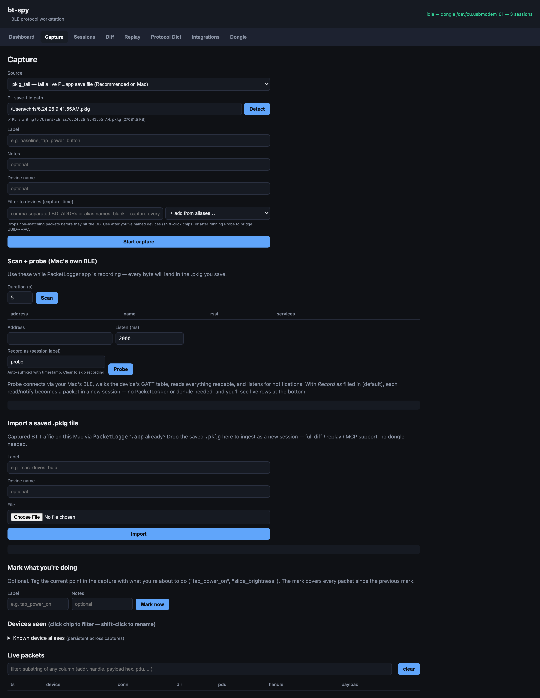
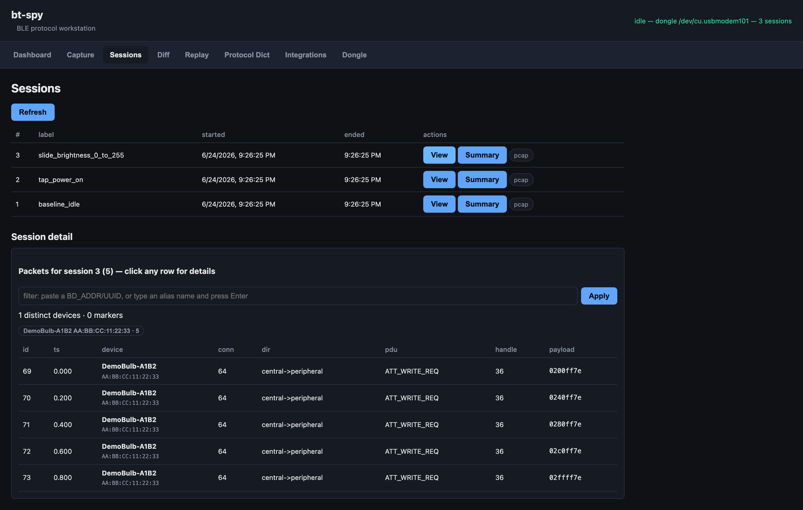
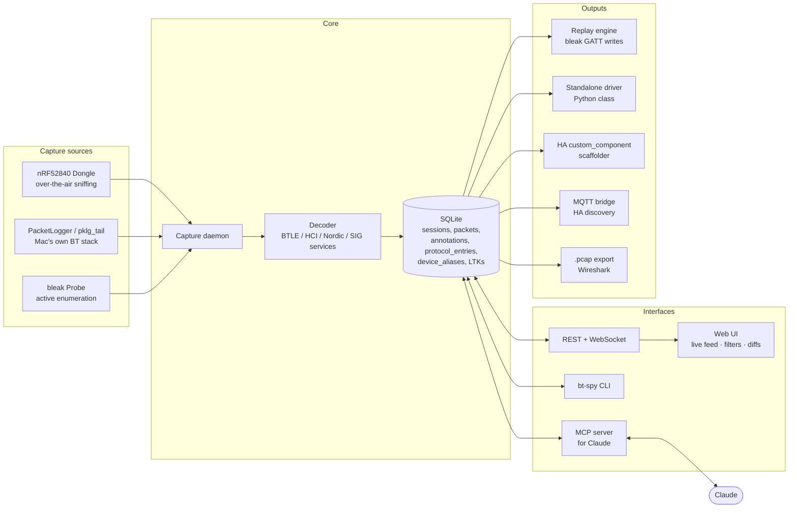
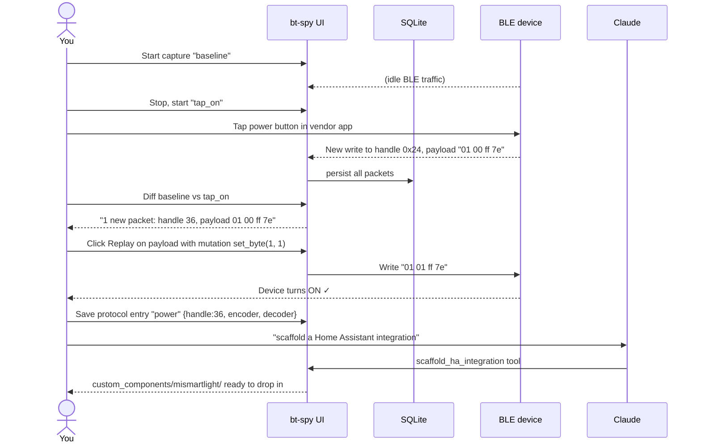

# bt-spy — BLE protocol reverse-engineering workstation

Sniff Bluetooth Low Energy traffic with a ~$12 nRF52840 USB Dongle (or with macOS's built-in
PacketLogger on your Mac's own BT controller), store every packet in SQLite, **diff sessions
to spot commands**, **replay them with mutations to confirm**, and let **Claude drive the
whole loop through an MCP server**. Then turn what you learn into a Python driver, a
Home Assistant `custom_component`, or an MQTT bridge — all auto-generated from a tiny
protocol-entry vocabulary.

Designed for macOS (Linux ports are 1-day), opinionated for the "I want to control my own
BLE device" use case.




---

## At a glance



---

## Quickstart

```bash
# 1. Install
git clone https://github.com/geekychris/bluetooth_spy.git bt-spy && cd bt-spy
./scripts/install.sh

# 2. Verify
source .venv/bin/activate
bt-spy doctor

# 3. Run the UI
bt-spy serve
# → open http://127.0.0.1:8765
```

You can start without any hardware: use **Scan** + **Probe** on the Capture tab to
talk to nearby BLE devices via your Mac's built-in BT and record a session in seconds.

To capture *other devices' traffic* (e.g., your phone ↔ your smart bulb), you need either:
- The **nRF52840 USB Dongle** (~$12, recommended) — over-the-air sniffing; see
  [docs/firmware-flashing.md](docs/firmware-flashing.md)
- **PacketLogger.app** with Apple's Bluetooth Debug Profile — for Mac-side HCI;
  see [docs/packetlogger.md](docs/packetlogger.md)

---

## The reverse-engineering loop



This loop is the core thing bt-spy accelerates — diff, replay, save, repeat.

---

## Documentation

| Doc | What's in it |
| --- | --- |
| [docs/user-guide.md](docs/user-guide.md) | Install, every command, every UI tab |
| [docs/architecture.md](docs/architecture.md) | System layers + sequence diagrams |
| [docs/data-model.md](docs/data-model.md) | SQLite schema + ER diagram |
| [docs/api-reference.md](docs/api-reference.md) | REST + WebSocket + MCP catalogue |
| [docs/firmware-flashing.md](docs/firmware-flashing.md) | nRF52840 dongle setup (modern nrfutil 8.x flow) |
| [docs/packetlogger.md](docs/packetlogger.md) | Mac-side HCI capture without hardware |
| [docs/protocol-re-tutorial.md](docs/protocol-re-tutorial.md) | Worked example, end-to-end |
| [docs/home-assistant.md](docs/home-assistant.md) | Driver export / HA scaffold / MQTT bridge |
| [docs/extending.md](docs/extending.md) | Add decoders, mutations, capture sources |

---

## Capabilities cheat sheet

| Want to… | Tool / command |
| --- | --- |
| See what's in BLE radio range | Capture tab → **Scan** |
| Talk to a specific BLE device | Capture tab → **Probe** (auto-records as a session) |
| Sniff OTA traffic between phone & device | nrf_sniffer capture (needs the dongle) |
| Sniff Mac ↔ device traffic | pklg_tail capture (needs PL.app + Apple's debug profile) |
| Filter capture to one device | Capture form → *Filter to devices*  (or sniffer-side `--follow` for nrf_sniffer) |
| Tag what action you're doing | *Mark now* form during capture |
| Find what changed between two captures | Sessions → Diff |
| Find what changed between two markers in one capture | Sessions → marker diff |
| Guess if byte N is a CRC | Session detail → Summary → **Find checksum** |
| Try every value of byte N | Replay tab → **Mutation sweep** |
| Get a working Python driver | Integrations tab → **Export driver** |
| Get a Home Assistant component | Integrations tab → **Scaffold integration** |
| Run as an MQTT bridge for HA | `bt-spy bridge --device X --ble ADDR --mqtt mqtt://broker` |
| Export to Wireshark | Sessions row → **pcap** link |
| Let Claude do all of the above | Add the MCP server to your Claude config (see API ref) |

---

## License

MIT.
