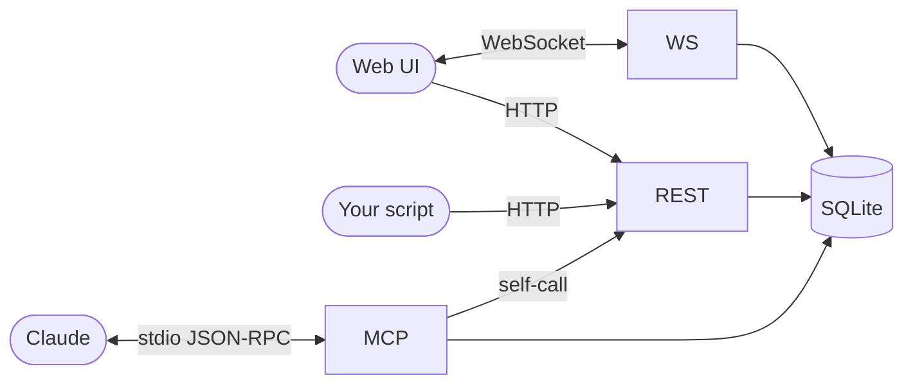
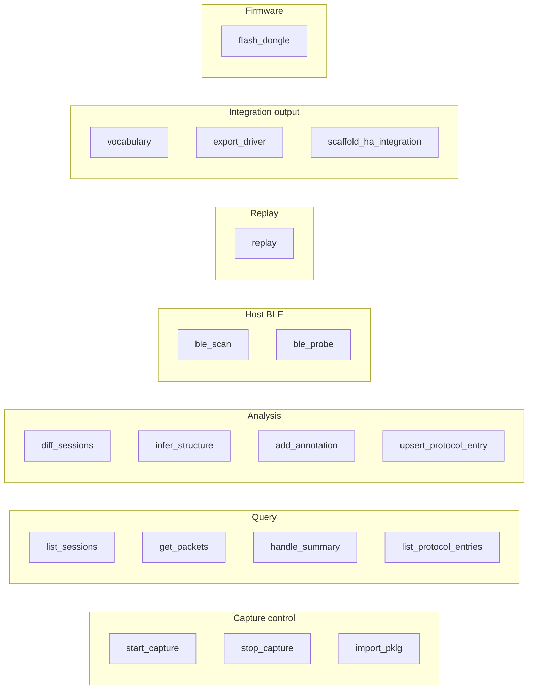

# API reference

Three surfaces:

1. **REST** — `bt-spy serve` exposes a FastAPI app on `http://127.0.0.1:8765`. Used by the web UI, by scripts, and by anything else that speaks HTTP.
2. **WebSocket** — `/ws/packets`. Live packet feed during active captures.
3. **MCP** — `bt-spy mcp` runs an MCP stdio server. Add it to your Claude config and Claude can drive everything.



## REST endpoints

Base URL: `http://127.0.0.1:8765`.

### Health

#### `GET /api/health`

System state. Used by the UI to detect dongle, PL.app, etc.

Response:
```json
{
  "ok": true,
  "version": "0.1.0",
  "db": "/Users/.../.bt-spy/bt-spy.db",
  "dongle_port": "/dev/cu.usbmodem101",
  "nrfutil_binary": "/opt/homebrew/bin/nrfutil",
  "extcap_script": "",
  "packetlogger_cli": "/Applications/PacketLogger.app/Contents/MacOS/PacketLogger",
  "packetlogger_app_present": true,
  "wireshark_present": true,
  "nrfutil_present": true,
  "capture_running": false,
  "capture_status": null,
  "sessions_total": 17
}
```

### Sessions

#### `GET /api/sessions`

List all sessions newest-first.

#### `POST /api/sessions`

Start a capture session.

```json
{
  "label": "tap_power",
  "notes": "optional",
  "source": "pklg_tail",                        // or "nrf_sniffer"
  "source_args": {"path": "/path/to/live.pklg"},  // pklg_tail needs this
  "device_filter": ["AA:BB:CC:DD:EE:FF"],       // optional; names resolve via alias DB
  "device_mac": null,
  "device_name": null
}
```

Returns `{session_id, label, device_filter: [resolved BD_ADDRs]}`.

#### `POST /api/sessions/{sid}/stop`

Stop a running capture. Cleanly terminates the source subprocess so blocked reads unblock immediately.

#### `GET /api/sessions/{sid}/packets`

Query packets. All filters are optional:

| Param | Type | Notes |
| --- | --- | --- |
| `handle` | int | Exact ATT handle |
| `direction` | string | `central->peripheral` etc |
| `pdu_type` | string | E.g. `ATT_WRITE_REQ` |
| `device_addr` | string | Single BD_ADDR / UUID |
| `device_name` | string | Resolves through `device_aliases` (handles privacy-address rotation) |
| `limit` | int (default 500) | |

Response: list of packet rows (payload + raw as hex strings).

#### `GET /api/sessions/{sid}/devices`

Distinct BD_ADDRs in this session with packet counts and resolved names from the alias DB.

#### `GET /api/sessions/{sid}/conn_handles`

Same shape but grouped by ACL connection handle.

#### `GET /api/sessions/{sid}/annotations`

All annotations/markers for this session.

#### `GET /api/sessions/{sid}/export.pcap`

Standards-compliant `.pcap` for Wireshark. Linktype picked from `capture_source`
(BTHCI_H4 for PL, BTLE_LL for nrf).

### Packets

#### `GET /api/packets/{pid}`

Full detail for one packet including parsed `decoded` field.

### Annotations & markers

#### `POST /api/annotations`

```json
{
  "session_id": 5,
  "packet_id_start": 12,
  "packet_id_end": 17,
  "label": "power_command",
  "notes": "confirmed via replay"
}
```

#### `POST /api/marker`

Tag the current capture frontier — packs everything since the previous marker into a new annotation.

```json
{"session_id": 5, "label": "tap_power_on", "notes": "tapped Power On in app"}
```

#### `POST /api/marker_diff`

Diff two annotation ranges within one session.

```json
{"baseline_annotation_id": 2, "candidate_annotation_id": 3}
```

Returns packets in `candidate` whose (handle, direction, payload) didn't appear in `baseline`.

#### `GET /api/annotations/{aid}/packets`

Every packet covered by an annotation's id range.

### Analysis

#### `GET /api/handle_summary/{sid}`

Per-handle stats: packet count, unique payloads, byte-by-byte variability profile.

#### `GET /api/checksum_hypotheses/{sid}?handle=N&direction=D`

Brute-force common checksums over payloads. Returns ranked hypotheses:

```json
[
  {
    "algo": "crc16_modbus_le",
    "input_start": 0,
    "input_end": 3,
    "output_offset": 3,
    "output_size": 2,
    "sample_count": 5
  }
]
```

### Replay & probing

#### `POST /api/replay`

Send a sequence of GATT writes with optional mutations.

```json
{
  "target": "MiSmartLight",
  "steps": [
    {
      "char_uuid": "0000fff1-0000-1000-8000-00805f9b34fb",
      "payload_hex": "0100ff7e",
      "mutation": {"strategy": "set_byte", "offset": 1, "value": 128},
      "write_with_response": false
    }
  ],
  "listen_for_notifications_ms": 1000
}
```

#### `POST /api/replay/sweep`

Send the base payload with one byte swept across a range. UI's mutation-sweep form.

```json
{
  "target": "MiSmartLight",
  "char_uuid": "0000fff1-0000-1000-8000-00805f9b34fb",
  "base_payload_hex": "0100ff7e",
  "offset": 1,
  "value_start": 0,
  "value_end": 255,
  "step": 16,
  "delay_ms": 200,
  "listen_ms_per_step": 500
}
```

#### `GET /api/ble/scan?duration=5`

BLE scan via the Mac's own Bluetooth. Returns nearby devices with names (resolved by CoreBluetooth), RSSI, service UUIDs, manufacturer data.

#### `POST /api/ble/probe`

Connect, enumerate GATT, read every readable characteristic, listen for notifies briefly.

```json
{
  "address": "5A7F1234-AAAA-BBBB-CCCC-DDDDEEEEFFFF",
  "listen_for_notifications_ms": 2000,
  "record_as": "probe_my_bulb"
}
```

If `record_as` is set, a session is created and each read/notify is written as a packet, broadcasting to the WebSocket so the live feed populates. If a capture is also running and the probed address has a known name, the response includes auto-bridged MAC→name aliases.

### Device aliases & LTKs

#### `GET /api/device_aliases`
#### `POST /api/device_alias`  — `{device_addr, name, source}` (`name=""` deletes)
#### `DELETE /api/device_alias/{addr}`

#### `GET /api/ltks`  — summary view; LTK hex truncated
#### `POST /api/ltk`  — `{device_addr, ltk_hex, rand_hex?, ediv?, notes?}`

### Protocol entries (the persistent knowledge dictionary)

#### `GET /api/protocol_entries`

#### `POST /api/protocol_entries`

```json
{
  "device_name": "MiSmartLight",
  "handle": 36,
  "char_uuid": "0000fff1-0000-1000-8000-00805f9b34fb",
  "direction": "central->peripheral",
  "name": "set_brightness",
  "structure": [{"offset":0,"length":1,"name":"cmd"}, {"offset":1,"length":1,"name":"level"}],
  "encoder_py": "def encode(level): return bytes([0x02, level & 0xff, 0xff, 0x7e])",
  "confidence": 0.9
}
```

Upserts by `(device_name, handle, direction, name)`.

### Integrations (output generators)

#### `GET /api/integrations/devices`
List devices with protocol entries — what's exportable.

#### `GET /api/integrations/vocabulary`
The canonical name→HA-platform mapping. Use this to pick entry names that auto-scaffold.

#### `POST /api/integrations/export_driver`
```json
{"device_name": "MiSmartLight", "out_dir": "./drivers"}
```
Returns `{path, bytes, code}` — the generated `drivers/mismartlight.py`.

#### `POST /api/integrations/scaffold_ha`
```json
{
  "device_name": "MiSmartLight",
  "out_dir": "./custom_components",
  "local_name": "MiLight*",
  "service_uuid": "0000fff0-0000-1000-8000-00805f9b34fb"
}
```
Returns `{paths, component_dir}` — the generated HA integration.

### Capture-related

#### `POST /api/import_pklg` — multipart upload (file, label, notes?, device_name?)
#### `GET /api/pklg/detect` — finds PL.app's currently-open save file via `lsof`
#### `POST /api/flash` — SSE-streamed nRF dongle flash progress (legacy zip flow)
#### `POST /api/flash/upload` — upload a manually-downloaded Nordic zip and flash

## WebSocket

### `WS /ws/packets`

Subscribe-only stream of packet events during active captures. Server pushes JSON
per packet:

```json
{
  "session_id": 5,
  "packet_id": 12345,
  "ts": 1.234,
  "direction": "central->peripheral",
  "pdu_type": "ATT_WRITE_REQ",
  "handle": 36,
  "conn_handle": 64,
  "device_addr": "AA:BB:CC:DD:EE:FF",
  "device_name": "Chris's iPhone 14",
  "opcode": 18,
  "payload_hex": "0100ff7e",
  "raw_hex": "...",
  "layers": ["HCI_Hdr", "HCI_ACL_Hdr", "L2CAP_Hdr", "ATT_Hdr", "ATT_Write_Request"]
}
```

The UI uses this to populate the live feed table and the auto-update device chips during capture.

## MCP server

Run `bt-spy mcp` (stdio) and add to your Claude Code config:

```json
{
  "mcpServers": {
    "bt-spy": {
      "command": "bt-spy",
      "args": ["mcp"]
    }
  }
}
```

### Catalogue



### Tool input schemas (excerpts)

#### `start_capture`
```json
{
  "label": "tap_power",
  "source": "pklg_tail",        // optional, "nrf_sniffer" by default
  "notes": "optional",
  "device_name": "optional"
}
```

#### `get_packets`
```json
{
  "session_id": 5,
  "handle": 36,                 // optional
  "direction": "central->peripheral",  // optional
  "pdu_type": "ATT_WRITE_REQ",  // optional
  "limit": 200
}
```

#### `diff_sessions`
```json
{
  "baseline_session_id": 2,
  "candidate_session_id": 5
}
```

#### `replay`
```json
{
  "target": "MiSmartLight",
  "steps": [{"char_uuid": "...", "payload_hex": "0100ff7e",
             "mutation": {"strategy": "set_byte", "offset": 1, "value": 128}}],
  "session_id": null,
  "listen_for_notifications_ms": 1000
}
```

#### `ble_probe`
```json
{
  "address": "5A7F1234-...",
  "record_as": "probe_iphone",
  "listen_for_notifications_ms": 2000
}
```

If a capture is running concurrently, the probe also tries to auto-bridge UUID ↔ MAC.

#### `scaffold_ha_integration`
```json
{
  "device_name": "MiSmartLight",
  "out_dir": "./custom_components",
  "local_name": "MiLight*",
  "service_uuid": "0000fff0-..."
}
```

Full input schemas are declared in [`src/bt_spy/mcp/server.py`](../src/bt_spy/mcp/server.py).

### A typical Claude conversation

> User: I just captured session 5 of me tapping brightness up/down in the vendor app
> for MiSmartLight. Figure out the protocol and ship me a Home Assistant integration.

Claude will roughly:

1. Call `list_sessions` to find session 5 plus the baseline session 3.
2. Call `diff_sessions(3, 5)` → returns just writes to handle 36.
3. Call `get_packets(5, handle=36)` → sees 5 unique payloads, all 4 bytes.
4. Call `infer_structure(5, 36)` → returns the byte-variability profile.
5. Call `vocabulary` → reminds itself that `set_brightness` is the right canonical name.
6. Call `replay(target, [{handle:36, payload_hex:"01 80 ff 7e"}])` → device sets brightness to ~50%.
7. Call `upsert_protocol_entry({device_name:"MiSmartLight", handle:36, name:"set_brightness", encoder_py: "...", ...})`.
8. Call `scaffold_ha_integration({device_name:"MiSmartLight", out_dir:"...", ...})`.
9. Tell you to drop the resulting directory into HA and restart.

## CLI

`bt-spy --help` lists everything. Key subcommands:

| Command | What it does |
| --- | --- |
| `bt-spy doctor` | Environment check (dongle, nrfutil, PL.app, profile) |
| `bt-spy serve` | REST + WebSocket + UI server |
| `bt-spy mcp` | MCP stdio server (for Claude config) |
| `bt-spy capture LABEL --source pklg_tail` | Start a capture (Ctrl-C to stop) |
| `bt-spy sessions` | List sessions |
| `bt-spy diff BASELINE CANDIDATE` | Session diff |
| `bt-spy scan` | BLE scan via Mac |
| `bt-spy probe ADDR --record-as LABEL` | Active GATT enumeration with session recording |
| `bt-spy replay TARGET 'JSON'` | Run a replay sequence |
| `bt-spy export-driver DEVICE --out drivers/` | Generate standalone Python driver |
| `bt-spy scaffold-ha DEVICE --out ~/.homeassistant/custom_components/` | Generate HA component |
| `bt-spy bridge --device X --ble ADDR --mqtt mqtt://...` | Long-running MQTT bridge |
| `bt-spy import-pklg FILE --label X` | Offline ingest of saved .pklg |
| `bt-spy flash --bundle PATH` | Legacy firmware flash from local zip |

Full reference: `bt-spy <command> --help`.
