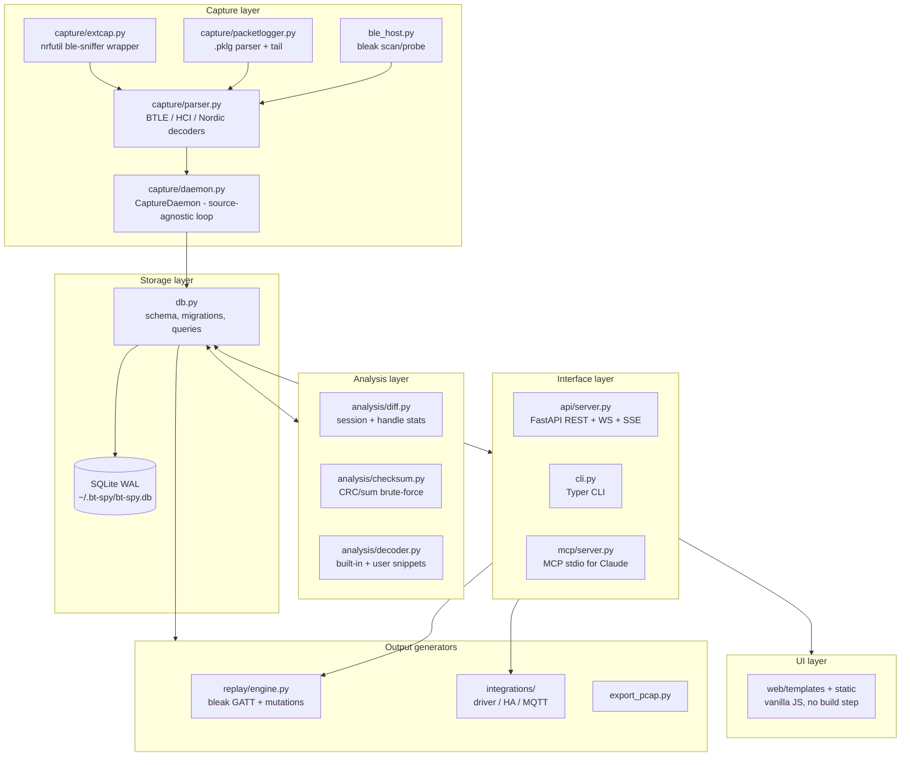
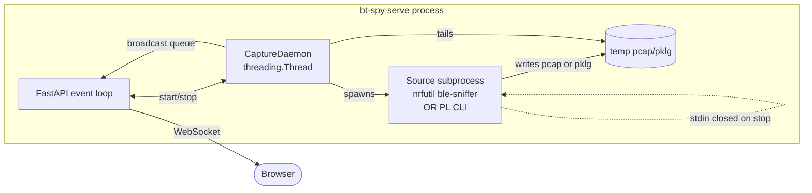
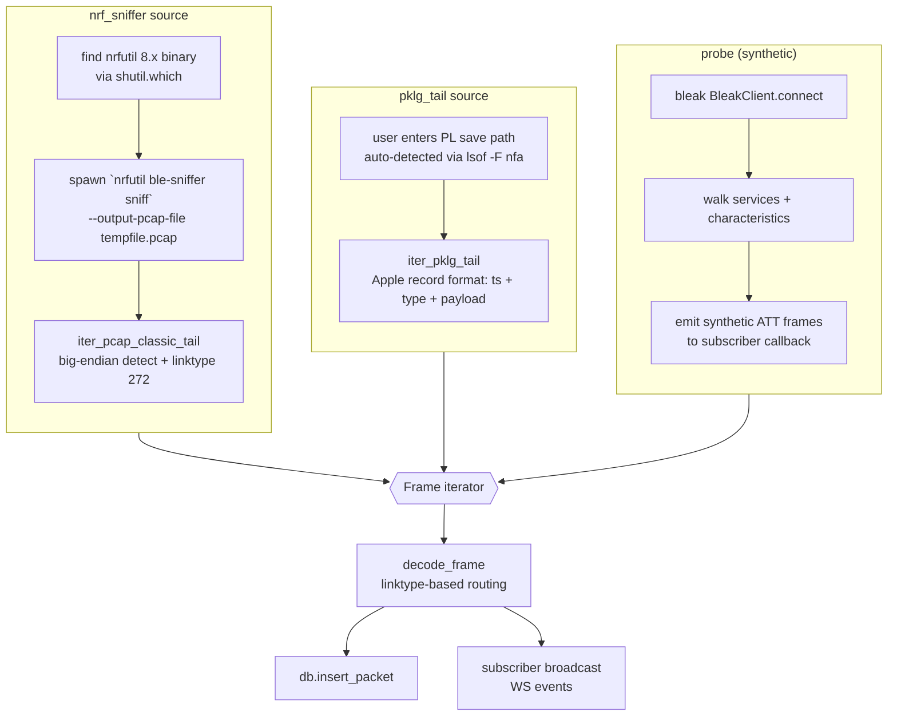
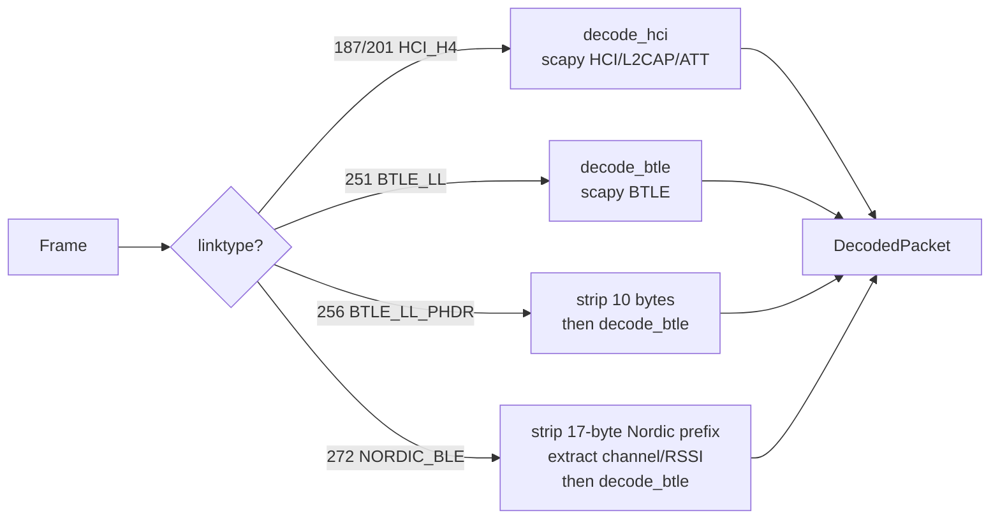
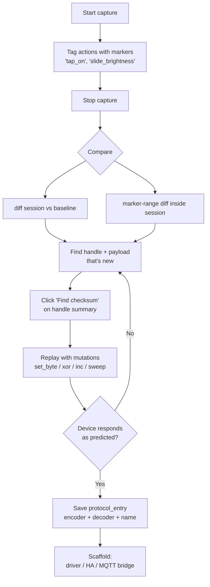
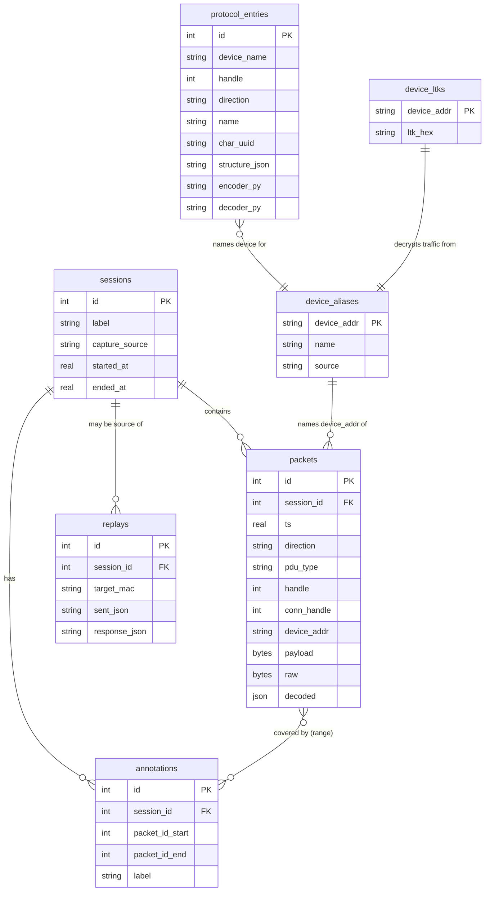
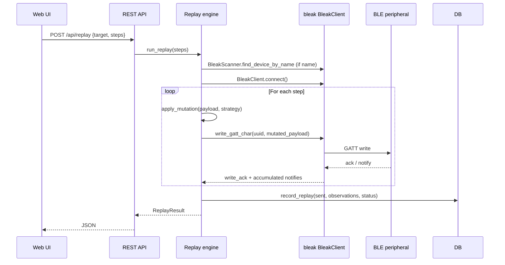
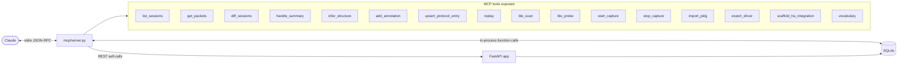
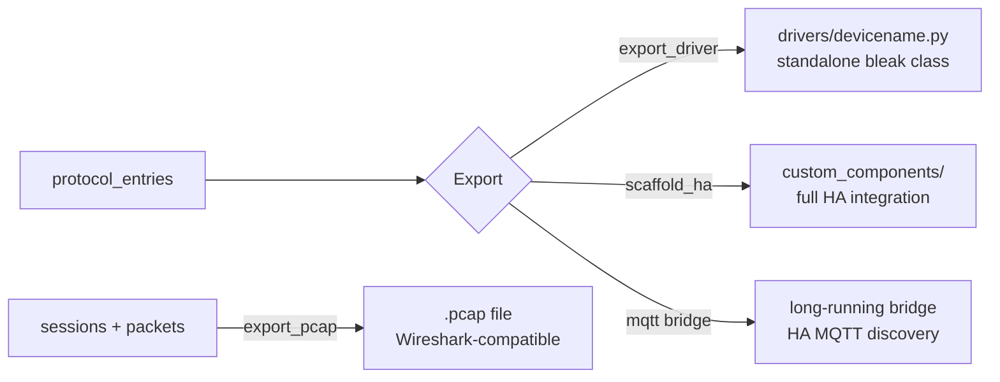

# Architecture

This is the deep dive into how bt-spy fits together. For *why* the architecture is
shaped this way, see [design.md](design.md). For *what the schema looks like*, see
[data-model.md](data-model.md).

## Top-level layers



The dotted-line invariant: **SQLite is the only durable state.** WebSocket
broadcasts, in-memory daemon caches, and the alias resolution layer are all
optimisations that can be rebuilt from the DB.

## Process model

bt-spy runs as a single Python process (`bt-spy serve` → uvicorn → FastAPI app).
Inside that process:



Key behaviours:

- **Capture in a thread, not the event loop.** Reading from a subprocess pipe is
  blocking I/O; doing it in the event loop would stall the WebSocket and REST
  handlers.
- **Cleanup via `_cleanup` callable.** When you click Stop, `daemon.stop()`
  sets `_stop`, invokes `_cleanup()` (which terminates the source subprocess
  and unlinks any tempfile), then joins the thread. This is why old "stuck
  capture" bugs are fixed — a blocked read on a dead subprocess unblocks the
  moment we kill the process.
- **Single MCP server, single REST server, single DB.** No coordination
  protocol needed because they're all in-process talking to the same SQLite.

## Capture sources & how they fit a uniform pipeline



Adding a new source is one function: anything yielding `parser.Frame` objects
can plug into `CaptureDaemon._start_source`. See [extending.md](extending.md).

## Decode routing

`decode_frame` dispatches based on the pcap linktype:



The decoder pulls these fields when present:

| Field | Where it comes from |
| --- | --- |
| `handle` | ATT handle (GATT-level, distinct from connection handle) |
| `opcode` | ATT op (write/read/notify/indicate) |
| `payload` | The bytes that get encoded/decoded by your protocol entries |
| `conn_handle` | HCI ACL link-layer connection handle (proxy for "which device" on connected traffic) |
| `device_addr` | BD_ADDR from advertising AdvA / HCI connection-complete / probe target |
| `device_name` | Local name from advertising AD records (only if device broadcasts it) |

## Reverse-engineering workflow



This loop is exactly what the UI and MCP tools are wired around. The "save
protocol_entry → scaffold" handoff is the moment the RE work turns into shippable
code.

## Storage model



Full schema reference: [data-model.md](data-model.md).

## Replay engine



Mutation strategies are pluggable via `@register_mutation(name)`. Out of the
box: `set_byte`, `xor_byte`, `increment_byte`, `replace`. Plus the **sweep**
variant which generates a strategy invocation per value in a range.

## MCP integration (Claude as the co-pilot)



Claude doesn't *replace* you — it accelerates the boring parts: pattern-finding
in payloads, structure hypotheses, replay configuration, scaffold generation.
You still drive the "what should I try next" decisions.

## Output generators



Driver export is the foundation — both the HA scaffold and the MQTT bridge
*import* the generated driver so they stay in sync as you refine encoders.

## Threading + concurrency

bt-spy runs three concurrent contexts:

| Context | What runs in it | Lifetime |
| --- | --- | --- |
| FastAPI event loop | REST handlers, WS clients, MCP tool dispatch | bt-spy serve uptime |
| CaptureDaemon thread | source subprocess + pcap/pklg tailer + decode + DB write | One per capture session |
| bleak event loop | replay + probe + scan (async, runs on FastAPI loop) | Per request |

Concurrency-safety relies on SQLite's WAL mode: readers (REST handlers,
analysis) don't block the capture daemon writer. The only place we serialize
explicitly is the daemon's `db.insert_packet` — sqlite3's default isolation
handles the rest.

## File layout

```
src/bt_spy/
├── cli.py                      # Typer CLI entry
├── config.py                   # Settings (env-overridable)
├── db.py                       # SQLite schema, migrations, queries
├── ble_host.py                 # bleak scan + probe
├── export_pcap.py              # Wireshark-compatible export
│
├── capture/
│   ├── daemon.py               # CaptureDaemon (source-agnostic loop)
│   ├── extcap.py               # nrfutil + legacy Wireshark wrapper
│   ├── packetlogger.py         # Apple PL .pklg parser + tail
│   └── parser.py               # pcap/pcap-ng readers + decoders
│
├── analysis/
│   ├── decoder.py              # built-in + snippet decoders
│   ├── diff.py                 # handle summary + structure inference
│   └── checksum.py             # CRC/sum/xor brute force
│
├── replay/
│   └── engine.py               # bleak GATT writes + mutation strategies
│
├── integrations/
│   ├── vocabulary.py           # canonical entry name → HA platform
│   ├── driver.py               # standalone Python driver export
│   ├── homeassistant.py        # custom_component scaffolder
│   └── mqtt_bridge.py          # long-running MQTT bridge
│
├── firmware/
│   └── flasher.py              # Legacy zip-download path (kept for fallback)
│
├── decoders/                   # Drop-in built-in decoders
│   ├── example_battery.py
│   └── sig_standard.py
│
├── api/
│   └── server.py               # FastAPI app: REST, WS, SSE, file upload
│
├── mcp/
│   └── server.py               # MCP stdio server for Claude
│
└── web/
    ├── templates/index.html    # Single-page UI
    └── static/{app.js, style.css}
```

## When to read what

| Want to understand… | Read |
| --- | --- |
| Why decisions were made | [design.md](design.md) |
| What the data looks like | [data-model.md](data-model.md) |
| How to call from code | [api-reference.md](api-reference.md) |
| How to add a decoder or capture source | [extending.md](extending.md) |
| What the user sees | [user-guide.md](user-guide.md) |
