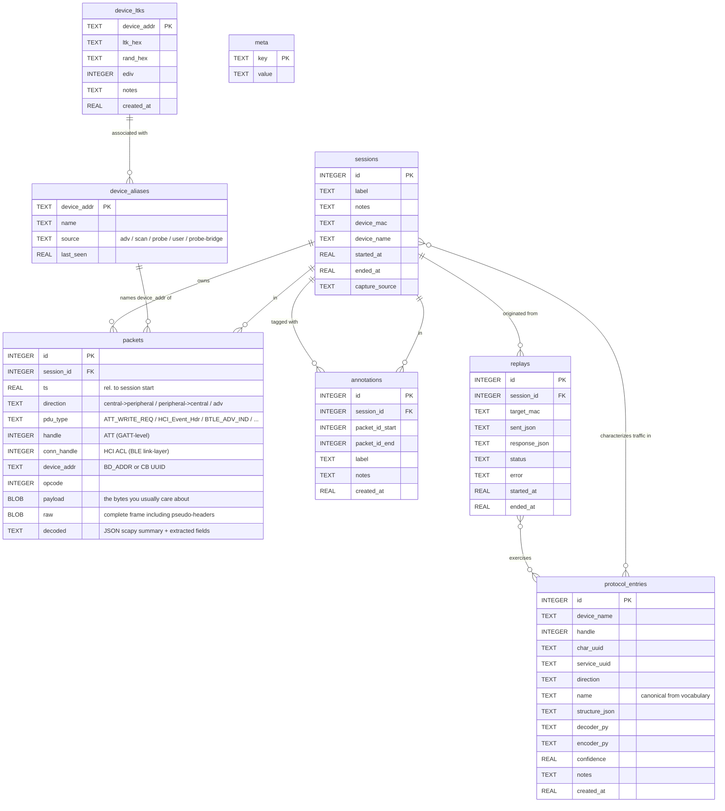

# Data model

The full SQLite schema. Every column, every relationship, every index. Schema
lives in [`src/bt_spy/db.py`](../src/bt_spy/db.py).

## ER diagram



## Tables

### `sessions` — capture metadata

| Column | Type | Notes |
| --- | --- | --- |
| `id` | INTEGER PK | Auto-increment session id |
| `label` | TEXT NOT NULL | What you typed in the form, e.g. `baseline`, `tap_power` |
| `notes` | TEXT | Free-text notes |
| `device_mac` | TEXT | Optional, for documenting the target |
| `device_name` | TEXT | Optional, for documenting the target |
| `started_at` | REAL NOT NULL | Wall-clock Unix time (UTC) |
| `ended_at` | REAL | Set when capture stopped cleanly |
| `capture_source` | TEXT NOT NULL DEFAULT `'nrf_sniffer'` | One of: `nrf_sniffer`, `packetlogger`, `pklg_tail`, `ble_host_probe` |

A session ending vs being active: `ended_at IS NULL` ⇒ in progress (or daemon crashed).

### `packets` — every BLE frame captured

| Column | Type | Notes |
| --- | --- | --- |
| `id` | INTEGER PK | Globally-unique packet ID |
| `session_id` | INTEGER FK → sessions | CASCADE on session delete |
| `ts` | REAL NOT NULL | Seconds since session start (monotonic) |
| `direction` | TEXT | `central->peripheral` / `peripheral->central` / `adv` / `host->controller` / `controller->host` |
| `pdu_type` | TEXT | scapy class name (`ATT_WRITE_REQ`, `BTLE_ADV_IND`, `HCI_Command_Hdr`, …) |
| `handle` | INTEGER | ATT handle (GATT-level), when applicable |
| `conn_handle` | INTEGER | HCI ACL link-layer connection handle (proxy for "which device" on connected traffic) |
| `device_addr` | TEXT | BD_ADDR (`AA:BB:CC:DD:EE:FF`) or CoreBluetooth UUID |
| `opcode` | INTEGER | ATT opcode byte |
| `payload` | BLOB | Just the value bytes (the part you usually mutate/diff) |
| `raw` | BLOB NOT NULL | Complete frame including pseudo-headers |
| `decoded` | TEXT | JSON: scapy summary + linktype-specific metadata (channel, RSSI, etc.) |

**Indexes**:
- `idx_packets_session(session_id, ts)` — primary access pattern is "all packets in this session in order"
- `idx_packets_handle(session_id, handle)` — for "all writes to handle X"
- `idx_packets_conn(session_id, conn_handle)` — for "all packets for connection X"
- `idx_packets_addr(session_id, device_addr)` — for "all packets from device X"

### `annotations` — markers and protocol entries' source

| Column | Type | Notes |
| --- | --- | --- |
| `id` | INTEGER PK | |
| `session_id` | INTEGER FK | |
| `packet_id_start` | INTEGER NOT NULL | Inclusive |
| `packet_id_end` | INTEGER NOT NULL | Inclusive |
| `label` | TEXT NOT NULL | Display name |
| `notes` | TEXT | |
| `created_at` | REAL NOT NULL | |

A "marker" (from the *Mark now* form) is an annotation. The
*[marker-range diff](architecture.md#reverse-engineering-workflow)* finds new
packets in one annotation's range vs another's.

### `protocol_entries` — the persistent knowledge dictionary

| Column | Type | Notes |
| --- | --- | --- |
| `id` | INTEGER PK | |
| `device_name` | TEXT | E.g. `MiSmartLight` |
| `handle` | INTEGER NOT NULL | ATT handle |
| `char_uuid` | TEXT | Needed for HA / driver export |
| `service_uuid` | TEXT | Used for HA bluetooth matchers |
| `direction` | TEXT NOT NULL | |
| `name` | TEXT NOT NULL | Canonical from `integrations.vocabulary` for auto-scaffold |
| `structure_json` | TEXT NOT NULL | Field layout as JSON list |
| `decoder_py` | TEXT | `def decode(payload) -> dict` snippet |
| `encoder_py` | TEXT | `def encode(**kw) -> bytes` snippet |
| `confidence` | REAL NOT NULL DEFAULT 0.5 | 0..1 |
| `notes` | TEXT | |
| `created_at` | REAL NOT NULL | |

**Unique**: `(device_name, handle, direction, name)` — upserts replace by this key.

A populated `protocol_entries` table for a device is *all* the input needed to
generate a working Python driver, a Home Assistant component, and an MQTT
bridge — see [home-assistant.md](home-assistant.md).

### `device_aliases` — addr ↔ name lookup

| Column | Type | Notes |
| --- | --- | --- |
| `device_addr` | TEXT PK | BD_ADDR (`AA:BB:CC:DD:EE:FF`) or CoreBluetooth UUID |
| `name` | TEXT NOT NULL | Friendly name |
| `source` | TEXT | `adv` / `scan` / `probe` / `user` / `probe-bridge` |
| `last_seen` | REAL NOT NULL | |

Populated automatically from:
- Advertising data when devices broadcast a Complete/Shortened Local Name
- bleak Scan results (CoreBluetooth-resolved names)
- bleak Probe → automatic UUID↔MAC bridging when a capture is running
- Manual shift-click rename in the UI

Names propagate through every UI: capture chips, packet detail, session view.

### `device_ltks` — encrypted-traffic decryption keys

| Column | Type | Notes |
| --- | --- | --- |
| `device_addr` | TEXT PK | |
| `ltk_hex` | TEXT NOT NULL | 16-byte LTK as 32 hex chars |
| `rand_hex` | TEXT | 8-byte RAND for legacy pairing |
| `ediv` | INTEGER | Encryption diversifier for legacy pairing |
| `notes` | TEXT | |
| `created_at` | REAL NOT NULL | |

Storage exists for future AES-CCM decryption. The nrfutil ble-sniffer subcommand
also accepts LTKs directly (`--legacy-ltk-key`, `--sc-ltk-key`); when a capture
is started with `nrf_sniffer` source and a matching `device_ltks` row exists,
the daemon will forward the key to the sniffer (planned).

### `replays` — receipts of what we sent and what came back

| Column | Type | Notes |
| --- | --- | --- |
| `id` | INTEGER PK | |
| `session_id` | INTEGER FK → sessions ON DELETE SET NULL | Source session, when relevant |
| `target_mac` | TEXT NOT NULL | |
| `sent_json` | TEXT NOT NULL | `[{handle, char_uuid, payload_hex, mutation?}, …]` |
| `response_json` | TEXT | `[{kind, handle, char_uuid, payload_hex, ts}, …]` |
| `status` | TEXT NOT NULL | `ok` / `error` / `timeout` |
| `error` | TEXT | |
| `started_at` | REAL NOT NULL | |
| `ended_at` | REAL | |

Every interactive replay (manual, MCP-driven, mutation sweep) lands here as a
single row. Useful for "what worked the last time I tried this".

### `meta` — KV store for schema version + bookkeeping

| Column | Type | Notes |
| --- | --- | --- |
| `key` | TEXT PK | |
| `value` | TEXT | |

Currently holds just `schema_version`. Used by the lightweight migration runner
in `db._migrate` so older DBs gain new columns without losing data.

## Migrations

`db.init_db()` runs the schema (`CREATE TABLE IF NOT EXISTS`) then calls
`_migrate(conn)` which uses `PRAGMA table_info(...)` to detect missing columns
and `ALTER TABLE` them in. Idempotent on every startup.

Adding a new column: bump `SCHEMA` AND add an idempotent `ALTER TABLE ... ADD
COLUMN` to `_migrate`. Indexes that depend on new columns must be created in
`_migrate`, not in the inline `SCHEMA`, because `CREATE INDEX IF NOT EXISTS`
fails if the column doesn't exist yet on legacy DBs.

## Storage location

```
~/.bt-spy/
├── bt-spy.db                # SQLite + WAL files
├── bt-spy.db-wal
├── bt-spy.db-shm
├── uploads/                 # .pklg files uploaded via the UI
├── firmware-cache/          # legacy sniffer bundle cache
└── nrf-sniffer-tail/        # temp pcap files for live nrf_sniffer captures
```

Backing up `bt-spy.db` is sufficient to migrate everything (sessions, packets,
annotations, protocol entries, replays, aliases, LTKs) to another Mac.
