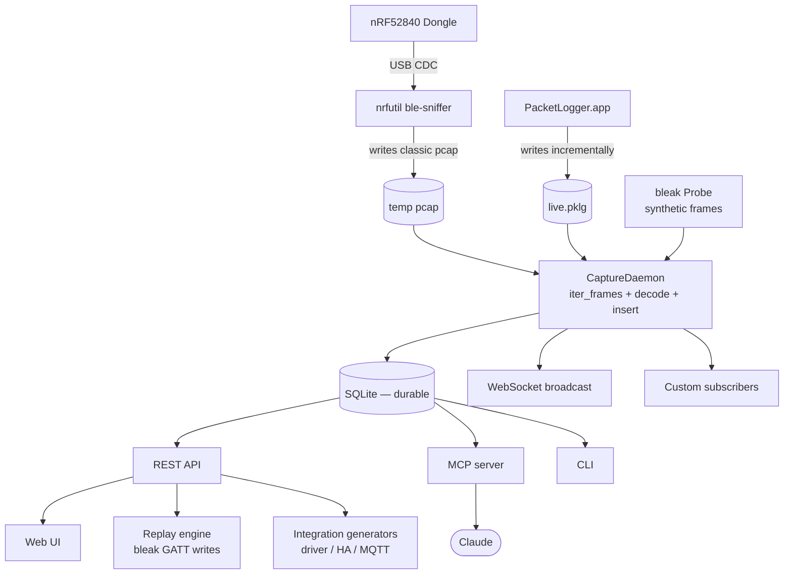

# bt-spy — Design

## Goals

1. **Lower the bar for BLE protocol reverse engineering** so a developer can go
   from "I want to control this thing" to "I have an API for this thing" in an
   afternoon, without needing prior RE experience.
2. **Make Claude a first-class collaborator** — every capability is reachable
   through an MCP server, and the storage model is a tabular knowledge graph
   Claude can read and write.
3. **Be extensible** — capture sources, decoders, mutation strategies, and
   protocol entries are all pluggable.
4. **Stay boring** — SQLite, FastAPI, Python. No big runtimes. No proprietary
   formats. Easy to fork and audit.

## Non-goals

- **Not** a man-in-the-middle that the device sees as the real peripheral.
  (That's a GATTacker-style tool; explicitly out of scope for v1.)
- **Not** a graphical Wireshark replacement. The UI is designed for protocol RE,
  not packet forensics.
- **Not** cross-platform yet. macOS first because that's the user's environment;
  Linux is a 1-day port (pyserial, bleak, nrfutil all work).

## Architecture



For more detailed diagrams see [architecture.md](architecture.md).

Three things to know:

1. **The DB is the only durable state.** Live broadcasts (WebSocket) and
   in-memory subscribers are optimisations. If the daemon crashes mid-capture,
   you lose nothing already written.
2. **Capture is one-direction.** The sniffer passively listens. To actively
   send/probe, the replay engine uses *host BLE* via bleak — a separate code
   path with a separate adapter (your Mac's built-in BLE). This is intentional:
   keeping passive sniff isolated from active connect makes the workflow easy
   to reason about (and avoids fighting the sniffer firmware for the radio).
3. **MCP and REST share everything.** Both wrap the same DB and replay engine.
   Use the REST API for the web UI and your own scripts; use MCP for Claude.

## Data model

The schema lives in [`src/bt_spy/db.py`](../src/bt_spy/db.py).

```
sessions(id, label, notes, device_mac, device_name, started_at, ended_at, capture_source)
   └── packets(id, session_id, ts, direction, pdu_type, handle, opcode,
               payload BLOB, raw BLOB, decoded JSON)
   └── annotations(id, session_id, packet_id_start, packet_id_end, label, notes, created_at)

protocol_entries(id, device_name, handle, direction, name, structure JSON,
                 decoder_py, encoder_py, confidence, notes, created_at)

replays(id, session_id, target_mac, sent JSON, response JSON,
        status, error, started_at, ended_at)
```

Why this shape:

- **Sessions are first-class.** RE workflow is *capture → diff*, so sessions
  are the unit of comparison. Storing the label ("baseline", "tap_power")
  means you can answer "what's new in tap_power" with a single SQL diff.
- **Packets store raw + decoded.** Raw bytes are ground truth; the JSON
  `decoded` column carries scapy's best-effort layer breakdown so neither has
  to be re-computed.
- **Protocol entries are the externalised knowledge.** Once you've
  confirmed "writes to handle 0x24 of the form `[01, brightness]` set
  brightness," that entry goes into `protocol_entries` with a small Python
  decoder/encoder snippet. Claude can read this dictionary on subsequent
  conversations and build on prior runs.
- **Replays are receipts.** Every send-attempt and what came back is stored,
  with a link to the session that inspired it.

## Reverse-engineering workflow

```
   ┌───────────┐         ┌───────────┐         ┌───────────┐
   │ baseline  │  diff   │  do_X     │  diff   │  do_Y     │  …
   │ (idle)    ├────────►│ (action X)├────────►│ (action Y)│
   └───────────┘         └─────┬─────┘         └─────┬─────┘
                               │ "what packets are new?"
                               ▼
                        ┌─────────────┐
                        │  handle h   │ "always writes to h with pattern P"
                        │  payload P  │
                        └──────┬──────┘
                               │ hypothesis: "byte i is value"
                               ▼
                        ┌─────────────┐  replay with mutation
                        │  replay     ├──────────────────────►  real device
                        │  (mutated)  │
                        └──────┬──────┘
                               │ confirmed
                               ▼
                        ┌─────────────┐
                        │  protocol   │  decoder_py / encoder_py
                        │  entry      │  saved for future use
                        └─────────────┘
```

The whole point of the storage model is to make this loop fast and resumable.

## Extension points

### Custom decoders

Drop a Python file into `src/bt_spy/decoders/`:

```python
from bt_spy.analysis.decoder import register_decoder

@register_decoder("MiSmartLight:36:central->peripheral")
def decode_brightness(payload: bytes) -> dict:
    return {"cmd": payload[0], "brightness": payload[1], "checksum": payload[2]}
```

These are auto-loaded by `autoload_builtin_decoders()`. For decoders that come
from RE work (not built-ins), save them as `protocol_entries.decoder_py`
snippets — those persist across machines via the SQLite DB.

### Custom mutation strategies

Add to `src/bt_spy/replay/engine.py` or any imported module:

```python
from bt_spy.replay.engine import register_mutation

@register_mutation("crc16_recompute")
def crc16_recompute(payload: bytes, *, offset: int) -> bytes:
    body, _ = payload[:offset], payload[offset:offset+2]
    import struct, binascii
    crc = binascii.crc_hqx(body, 0xFFFF)
    return body + struct.pack(">H", crc) + payload[offset+2:]
```

Then in your replay request: `{"strategy": "crc16_recompute", "offset": 14}`.

### Alternate capture sources

`CaptureDaemon` only depends on something yielding `parser.Frame`. To add
Android HCI snoop-log replay, write a function that yields frames from a
btsnoop file and have the daemon iterate that instead of the live extcap.
The DB schema is source-agnostic — only the `capture_source` column changes.

### Alternate replay backends

Want to replay through a GATTacker-style MITM rig? Implement the same
`run_replay(target, steps)` signature and wire the CLI/REST/MCP to dispatch
based on a `backend` arg. The engine module is intentionally small so this
swap is easy.

## Why these choices

- **scapy for decode** — lazily imported (so `--help` stays fast). scapy
  understands BTLE + ATT layers; we just walk the parsed tree.
- **SQLite, not Postgres** — single-file DB you can email. WAL mode keeps
  readers (UI/MCP) non-blocking while the capture daemon writes.
- **FastAPI + vanilla JS UI** — no build step, no dependency on a node toolchain.
  This is RE tooling: should run anywhere with Python.
- **Typer for CLI** — clean help, type hints, free shell completion if you want it.
- **Nordic extcap as subprocess** — Nordic owns their dongle protocol. We treat
  their script as a stable input. Less fragile than re-implementing the sniffer
  USB protocol ourselves.
- **bleak for host BLE** — only mature cross-platform BLE library in Python.
  Already speaks CoreBluetooth on macOS.

## Security note

This is RE tooling. Treat the decoder snippet runner as **not** a sandbox —
it constrains builtins but a determined snippet can still misbehave. Don't load
`protocol_entries` from sources you don't trust. The intended threat model is
"you and Claude are co-authors of the decoder snippets, both honest."
