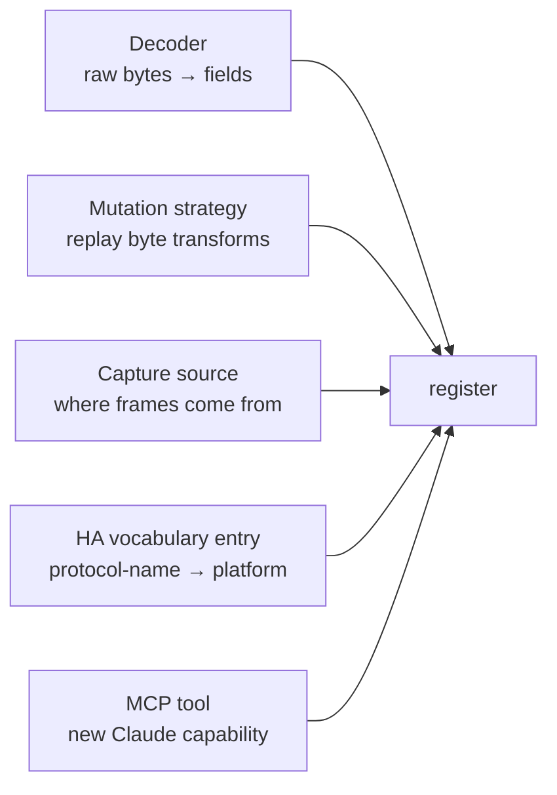
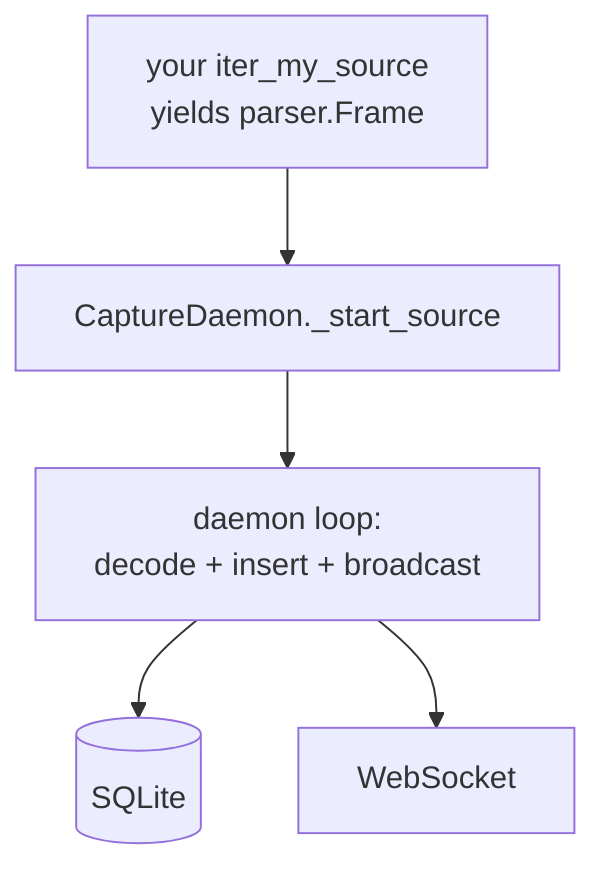

# Extending bt-spy

The architecture has explicit plugin points so you can add functionality without
forking. Five common things people want to extend:



## 1. Built-in decoders

A decoder turns raw payload bytes into a structured dict. Drop a Python file
into [`src/bt_spy/decoders/`](../src/bt_spy/decoders/) and call `@register_decoder`.

Keys follow the `device:handle_or_uuid:direction` shape. Use `"*"` as device for
"any device".

```python
# src/bt_spy/decoders/mismartlight.py
from bt_spy.analysis.decoder import register_decoder

@register_decoder("MiSmartLight:36:central->peripheral")
def decode_brightness(payload: bytes) -> dict:
    return {
        "cmd": payload[0],
        "brightness": payload[1],
        "tail": payload[-2:].hex(),
    }
```

For UUIDs (preferred — they're device-independent):

```python
@register_decoder("*:char:0000fff1-0000-1000-8000-00805f9b34fb")
def decode_my_proprietary_write(payload: bytes) -> dict:
    return {"cmd": payload[0], "value": payload[1]}
```

The SIG-standard service decoders shipping in
[`src/bt_spy/decoders/sig_standard.py`](../src/bt_spy/decoders/sig_standard.py)
are a good template — they handle Battery, Heart Rate, Device Info, Current
Time, and Tx Power for every device that exposes them.

### When to use a built-in decoder vs a `protocol_entries` snippet

| Approach | Use when |
| --- | --- |
| Built-in Python module | Decoder applies to many devices / shipping in the codebase |
| `protocol_entries.decoder_py` snippet | Device-specific, learned via RE workflow, persists in DB |

The snippet path is what the MCP `upsert_protocol_entry` tool writes to —
Claude saves discoveries here, you turn the well-tested ones into committed
modules when you feel like it.

## 2. Mutation strategies

The replay engine has pluggable byte-transform strategies. Built-ins:
`set_byte`, `xor_byte`, `increment_byte`, `replace`. Add yours by calling
`@register_mutation` anywhere that gets imported:

```python
# in your own module, or src/bt_spy/replay/engine.py
from bt_spy.replay.engine import register_mutation

@register_mutation("crc16_recompute")
def crc16_recompute(payload: bytes, *, offset: int) -> bytes:
    """Recompute and inject CRC-16-CCITT-FALSE over bytes [0..offset)."""
    import struct, binascii
    body = payload[:offset]
    crc = binascii.crc_hqx(body, 0xFFFF)
    return body + struct.pack(">H", crc) + payload[offset+2:]
```

Then in any replay step you pass to `/api/replay` or to the MCP `replay` tool:

```json
{"char_uuid": "...", "payload_hex": "0100ff0000", "mutation": {"strategy": "crc16_recompute", "offset": 3}}
```

The signature is always `(payload: bytes, **kwargs) -> bytes`. Keep them pure
— same input → same output.

## 3. Capture sources

`CaptureDaemon._start_source` resolves a source string to a `Frame` iterator.
Three sources ship today: `nrf_sniffer`, `pklg_tail`, `packetlogger` (legacy).
Adding a fourth: write a function that yields `parser.Frame(timestamp, linktype, raw)`
objects and wire it into the dispatch.



Skeleton:

```python
# src/bt_spy/capture/my_source.py
from typing import Iterator
from .parser import Frame, LINKTYPE_BLUETOOTH_LE_LL  # or 187 for HCI

def iter_my_source(*, stop_event=None) -> Iterator[Frame]:
    """Yield Frame objects until stop_event is set."""
    # Open whatever you're reading from (file, socket, subprocess, …)
    while not (stop_event and stop_event.is_set()):
        raw = next_frame()                # your own logic
        if raw is None:
            break
        yield Frame(timestamp=time.time(), linktype=LINKTYPE_BLUETOOTH_LE_LL, raw=raw)
```

Then in `capture/daemon.py`'s `_start_source`:

```python
if self.source == "my_source":
    return iter_my_source(stop_event=self._stop)
```

Update `StartCapture` in `api/server.py` if your source needs custom args:

```python
class StartCapture(BaseModel):
    source: str = "nrf_sniffer"   # add "my_source" to the docstring
    source_args: dict | None = None
```

Read `self.source_args.get("...")` inside your iter to pick up settings.

The daemon takes care of everything downstream: decoding, DB writes, WebSocket
broadcasts, filter application, marker support, alias backfill.

### Real example: PacketLogger tail

`capture/packetlogger.py`'s `iter_pklg_tail` is a worked example — opens a file
PL.app is writing to, parses Apple's record format, yields one Frame per HCI
event. Same pattern works for any incrementally-written capture file.

## 4. Home Assistant vocabulary

The HA scaffolder reads `protocol_entries.name` and looks it up in
[`integrations/vocabulary.py`](../src/bt_spy/integrations/vocabulary.py) to
decide which HA platform to generate (light, sensor, switch, etc.).

Adding a new mapping is a one-line dict entry:

```python
# in vocabulary.py
WRITES_TO_PLATFORM = {
    ...
    "set_water_temperature": ("water_heater", "target_temp"),
    "open_blind": ("cover", "primary_on_off"),
}

READS_TO_PLATFORM = {
    ...
    "water_temperature": ("sensor", "value",
                          {"device_class": "temperature", "unit": "°C"}),
    "blind_position": ("sensor", "value", {"unit": "%"}),
}
```

After adding the key, **also update the platform file generator** in
`integrations/homeassistant.py` if the new platform isn't already produced
(`_water_heater_py(...)` for example). Existing platforms (light, switch, fan,
cover, climate, lock, sensor, binary_sensor) just need a vocab entry —
their generators are already there.

## 5. MCP tools

The Claude-facing MCP server registers tools via `@server.list_tools()` +
`call_tool()`. Adding a new tool means:

1. Add an entry to `list_tools()` return value with name, description, and JSON schema.
2. Add a branch in `_dispatch()` that runs the actual logic.
3. Restart bt-spy MCP (Claude reloads the tool list on next conversation).

```python
# in src/bt_spy/mcp/server.py
@server.list_tools()
async def list_tools():
    return [
        ...
        Tool(
            name="export_session_csv",
            description="Export all packets of a session as CSV for spreadsheet analysis.",
            inputSchema={
                "type": "object",
                "properties": {
                    "session_id": {"type": "integer"},
                    "out_path": {"type": "string"},
                },
                "required": ["session_id", "out_path"],
            },
        ),
    ]

async def _dispatch(name, args):
    ...
    if name == "export_session_csv":
        import csv
        rows = db.get_packets(db.init_db(), args["session_id"])
        with open(args["out_path"], "w", newline="") as f:
            w = csv.writer(f)
            w.writerow(["id", "ts", "device_addr", "handle", "payload_hex"])
            for r in rows:
                w.writerow([
                    r["id"], r["ts"], r["device_addr"], r["handle"],
                    bytes(r["payload"]).hex() if r["payload"] else "",
                ])
        return {"path": args["out_path"], "row_count": len(rows)}
```

Schema follows JSON Schema's `inputSchema` style. Claude uses it to know which
fields are required and what types to send.

## 6. UI tabs and routes

The single-page UI lives in [`src/bt_spy/web/`](../src/bt_spy/web/). No build
step — `index.html` + `app.js` + `style.css`. To add a tab:

1. Add a `<button class="tab" data-tab="myname">My Tab</button>` to the `<nav class="tabs">`.
2. Add a matching `<section id="tab-myname" class="panel">...</section>`.
3. Hook into `switchTab(name)` in `app.js`:
   ```js
   if (name === 'myname') loadMyTabData();
   ```
4. Write `loadMyTabData()` to fetch from your REST endpoints and render.

REST endpoints just get added to `api/server.py` — FastAPI picks them up automatically when uvicorn reloads.

## What NOT to extend

Three things are *deliberately* simple and shouldn't be made pluggable:

- **The SQLite schema.** Add columns via the migration runner; don't introduce an ORM. The schema is the contract.
- **The capture daemon's threading model.** One thread per active capture. If you need parallelism inside a source, do it in your source iterator's own threads — keep the consumer single-threaded.
- **The scapy dependency.** Scapy understands BLE link-layer + HCI + ATT in one library. Replacing it would mean re-implementing decoders for hundreds of opcodes.

## Testing your extension

`pytest` runs all the existing tests in `tests/`. Add yours alongside:

```python
# tests/test_my_extension.py
from bt_spy.analysis.decoder import _REGISTRY, autoload_builtin_decoders

def test_my_decoder_registers():
    autoload_builtin_decoders()
    assert "MiSmartLight:36:central->peripheral" in _REGISTRY
    fn = _REGISTRY["MiSmartLight:36:central->peripheral"]
    assert fn(bytes([0x01, 0x80, 0xff, 0x7e])) == {"cmd": 1, "brightness": 128, "tail": "ff7e"}
```

Run with `./scripts/run-tests.sh`.

## Where to look in the code

| Extension point | File |
| --- | --- |
| Decoder registry | `analysis/decoder.py` |
| Mutation registry | `replay/engine.py` |
| Capture source dispatch | `capture/daemon.py::_start_source` |
| Frame decode routing | `capture/parser.py::decode_frame` |
| HA vocabulary | `integrations/vocabulary.py` |
| HA scaffold generator | `integrations/homeassistant.py` |
| MCP tools | `mcp/server.py::list_tools` + `_dispatch` |
| REST routes | `api/server.py` |
| UI tabs | `web/templates/index.html` + `web/static/app.js` |
