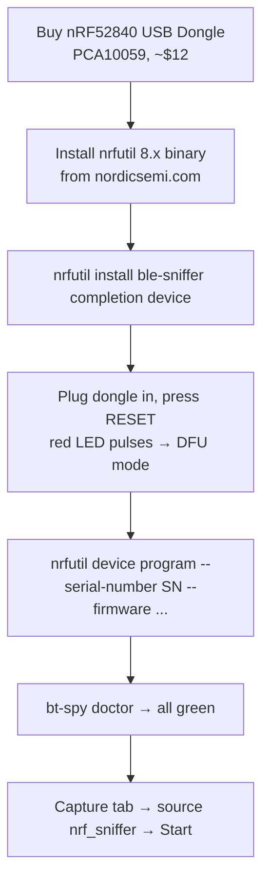
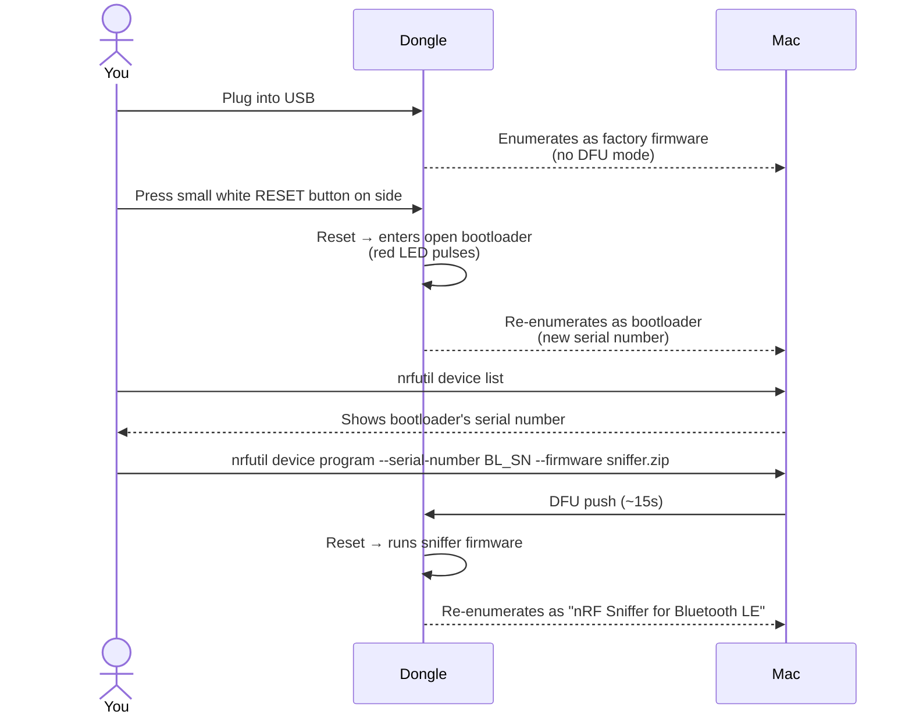
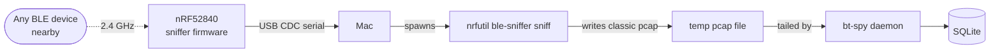

# Firmware flashing — nRF52840 USB Dongle

bt-spy turns a ~$12 Nordic nRF52840 USB Dongle into a real BLE sniffer that
can capture **any** BLE traffic in radio range (not just traffic involving
your Mac). This page walks through the modern setup using nrfutil 8.x, which
is the current Nordic-recommended flow as of 2025.

## High-level flow



## What hardware to get

**Buy the nRF52840 USB Dongle (PCA10059)**. Other Nordic boards (52840 DK,
52833 DK, 52 DK) also work but are full development kits costing $50+ and are
overkill unless you also plan to write custom BLE firmware.

- **Manufacturer**: Nordic Semiconductor
- **Part number**: nRF52840-DONGLE, PCA10059
- **Vendors**: element14, Mouser, DigiKey, Adafruit
- **Form factor**: USB-A stick about the size of a thumbnail
- **Cost**: ~$12

If you get a knockoff (makerdiary's MDK USB Dongle, Adafruit's Feather Express),
the firmware below won't fit — they use different bootloaders. Only PCA10059.

## What software you need

Two things, both free:

1. **nrfutil 8.x binary** — Nordic's standalone tool for managing their hardware
2. **The `ble-sniffer` subcommand** — installed *into* nrfutil via the binary's plugin system

Together they give you everything bt-spy needs: the dongle firmware, the
command-line capture tool, and (optionally) Wireshark integration.

> **Important name collision**: there are two different tools called `nrfutil`.
> The **old** one is a Python pip package (`pip install nrfutil` — maxes at
> Python 3.10, has `dfu/pkg` subcommands but NOT `install`). The **new** one
> is Nordic's standalone binary (`install/device/ble-sniffer` subcommands).
> You want the *new* one. If `nrfutil --version` shows 6.x you have the old one.

## Step 1 — install nrfutil 8.x

Download `nrfutil` (macOS universal) from
<https://www.nordicsemi.com/Products/Development-tools/nRF-Util/Download>.

```bash
# Remove the old Python nrfutil if it's on your system (it'll shadow the new one):
pip uninstall nrfutil    # or pip3 uninstall nrfutil — may say "not installed", fine

# Make the downloaded binary executable + put it on PATH:
chmod +x ~/Downloads/nrfutil
sudo mv ~/Downloads/nrfutil /opt/homebrew/bin/nrfutil       # Apple Silicon
# or:
# sudo mv ~/Downloads/nrfutil /usr/local/bin/nrfutil        # Intel Macs

# macOS Gatekeeper marks downloaded binaries as untrusted. Strip it:
sudo xattr -cr $(which nrfutil)

# If the first run still triggers "move to trash":
#   System Settings → Privacy & Security → "Allow Anyway" for nrfutil
#   then re-run. Or codesign locally:
sudo codesign --force --deep --sign - $(which nrfutil)

# Confirm:
hash -r
nrfutil --version    # Should show 8.x
```

## Step 2 — install the ble-sniffer subcommand

```bash
nrfutil install ble-sniffer completion device
```

This downloads ~30 MB into `~/.nrfutil/` including:

- `~/.nrfutil/share/nrfutil-ble-sniffer/firmware/sniffer_nrf52840dongle_*.zip` — what gets flashed onto the dongle
- The `ble-sniffer` command itself (you'll use `nrfutil ble-sniffer sniff` to capture)
- The `device` command (you'll use `nrfutil device program` to flash)

```bash
# (Optional) Wireshark integration — installs a shim Wireshark can call directly
nrfutil ble-sniffer bootstrap
```

## Step 3 — flash the dongle



In commands:

```bash
# 1. Plug in dongle.

# 2. Press the small white button on the SIDE of the dongle (not the end).
#    The red LED should immediately start pulsing slowly.
#    If no pulse:
#      - Try a different USB-A port (some hubs are flaky for DFU)
#      - Hold the button while plugging in
#      - Confirm it's a PCA10059 (silkscreen on back)

# 3. Find the bootloader serial number:
nrfutil device list

# You'll see a single device. Note its serial number (16 hex chars).
# IMPORTANT: This is the BOOTLOADER serial. It changes when you enter DFU mode.
# If you skip the reset-button press, you get the running app's serial instead,
# and `device program` will refuse with "operation not available for this device".

# 4. Flash. The firmware path is what `nrfutil install ble-sniffer` put down:
nrfutil device program \
  --serial-number <BL_SN_FROM_DEVICE_LIST> \
  --firmware ~/.nrfutil/share/nrfutil-ble-sniffer/firmware/sniffer_nrf52840dongle_nrf52840_*.zip
```

Flash takes ~15 seconds. The dongle re-enumerates with manufacturer "ZEPHYR"
and product "nRF Sniffer for Bluetooth LE".

## Step 4 — verify bt-spy sees it

```bash
bt-spy doctor
```

Expected:

```
┌─────────────────────┬────────┬───────────────────────────────────┐
│ check               │ status │ detail                            │
├─────────────────────┼────────┼───────────────────────────────────┤
│ data dir            │ ✓      │ ~/.bt-spy                         │
│ db                  │ ✓      │ ~/.bt-spy/bt-spy.db               │
│ dongle              │ ✓      │ /dev/cu.usbmodemXXX               │
│ nrfutil ble-sniffer │ ✓      │ /opt/homebrew/bin/nrfutil         │
│ nrfutil             │ ✓      │ found                             │
│ wireshark           │ ✓ or ? │ optional                          │
│ PacketLogger (live) │ ✓ or ? │ optional, only for HCI captures   │
└─────────────────────┴────────┴───────────────────────────────────┘
```

If `nrfutil ble-sniffer` shows ✗ but `nrfutil` shows ✓, you likely still have
the old Python `nrfutil` shadowing the new binary. Re-run `pip uninstall
nrfutil`, then `hash -r`, then re-check.

## Step 5 — capture

In bt-spy's web UI (`bt-spy serve` → http://127.0.0.1:8765):

- **Capture** tab
- **Source**: `nrf_sniffer`
- **Label**: whatever
- Click **Start capture**

Within a second you'll see live OTA packets in the bottom feed — every BLE
device in radio range advertising, plus any connection traffic. Device chips
appear automatically as each unique BD_ADDR is seen.

## Sniffer-side device filter

If you only care about traffic from one device, paste its BD_ADDR into
**Filter to devices** before starting. bt-spy translates that into
`nrfutil ble-sniffer sniff --follow <addr>` — the sniffer firmware then
*only hops channels for that device*, which dramatically reduces capture
size and works much better than software filtering.

## Common failures

### "The operation you tried to run is not available for the selected device"

You used the wrong serial number. The number changes when you enter DFU mode.
Press the reset button, re-run `nrfutil device list`, use the *new* serial.

### "Device or resource busy"

bt-spy is already running a capture and holding the dongle. Stop the capture
in the UI, then try again. Or `lsof /dev/cu.usbmodemXXX` to confirm what's
using it.

### Capture starts but live feed stays empty

- No BLE devices are advertising right now. Try opening BT settings on your phone or pulling AirPods out of the case to wake them up.
- Check the doctor output — if the dongle port has changed (some captures leave it stuck), unplug + replug.
- The OTA dongle picks up *unencrypted* advertising. If everything around you is in coded PHY mode or extended advertising, scapy may not decode it yet.

### Gatekeeper kills nrfutil with "killed" status

```bash
sudo xattr -cr $(which nrfutil)
sudo codesign --force --deep --sign - $(which nrfutil)
```

Then approve in Privacy & Security if it pops the dialog again.

## Legacy path: manual zip flash (kept for fallback)

bt-spy's old "download zip and flash" UI button is still wired — useful if for
some reason `nrfutil install ble-sniffer` doesn't work on your network.
Download the bundle from Nordic in a browser, then **Dongle tab → "Upload +
flash"**. Internally it does the same DFU push.

## What the dongle physically does



The sniffer firmware hops through BLE's 40 channels (37 data + 3 advertising)
following whatever it can latch onto, decapsulates the link-layer frames, and
sends them to your Mac over a USB virtual serial port. nrfutil writes them
into a pcap file. bt-spy tails that pcap and decodes each frame.

The dongle has no batteries or radio modulation logic of its own — everything is
just the standard nRF52840 SoC plus Nordic's sniffer firmware. You can flash
it back to a different firmware (custom BLE peripheral, openthread, whatever)
at any time using the same `nrfutil device program` flow.

## Related docs

- [user-guide.md](user-guide.md) — how to use what you just flashed
- [packetlogger.md](packetlogger.md) — Mac-side HCI capture (no hardware needed)
- [protocol-re-tutorial.md](protocol-re-tutorial.md) — end-to-end RE walkthrough
