# Home Assistant integrations


`bt-spy` turns your reverse-engineered protocol entries into:

1. **A standalone Python driver** for the device — works anywhere.
2. **A Home Assistant `custom_component`** that wraps that driver — the proper HA-native option.
3. **An MQTT bridge** — runs as a long-lived process; HA picks up entities via MQTT discovery.

You don't have to commit to one — they share the same input (`protocol_entries`)
and can coexist.

## How the three outputs relate

```mermaid
flowchart LR
    PE[protocol_entries<br/>your RE knowledge dict]

    PE --> DRV[Standalone driver<br/>drivers/mismartlight.py]
    PE --> HA[HA custom_component<br/>custom_components/mismartlight/]
    PE --> MQTT[MQTT bridge<br/>bt-spy bridge --mqtt …]

    DRV --> SCRIPT([Use from any Python<br/>script / Node-RED / pyscript])
    HA --> HAINST([Drop into Home Assistant<br/>+ restart])
    MQTT --> BROKER([Any MQTT-aware<br/>HA instance])

    classDef gen fill:#1d2230,stroke:#60a5fa
    class DRV,HA,MQTT gen
```



The HA scaffold *imports* the standalone driver, so improvements to your encoders
flow through to both. The MQTT bridge is the "I don't want to maintain a
custom_component" escape hatch.

## The naming convention that unlocks everything

The scaffolders read `protocol_entries.name` and look it up in a small canonical
vocabulary. If your name is in the vocabulary, the scaffolder knows which HA
platform to put it on. If not, the entry still ends up as a method on the driver
but lands as a TODO in the integration.

| Write entry name             | HA platform | Role               |
| ---------------------------- | ----------- | ------------------ |
| `power`, `set_state`         | switch¹     | on/off             |
| `set_brightness`             | light       | brightness         |
| `set_color_rgb`              | light       | RGB color          |
| `set_color_temp`             | light       | color temperature  |
| `set_position`               | cover       | position 0–100     |
| `set_target_temperature`     | climate     | target temperature |
| `set_hvac_mode`              | climate     | heat/cool/off/auto |
| `set_fan_speed`              | fan         | speed              |
| `lock`, `unlock`             | lock        | lock state         |

¹ If both `power` and `set_brightness` exist for the same device, the scaffolder
*coalesces* them onto a single light entity rather than creating a phantom switch.

| Read entry name              | HA platform     | Notes                                  |
| ---------------------------- | --------------- | -------------------------------------- |
| `battery_level`              | sensor          | `%` `device_class=battery`             |
| `temperature`                | sensor          | `°C` `device_class=temperature`        |
| `humidity`                   | sensor          | `%` `device_class=humidity`            |
| `illuminance`                | sensor          | `lx`                                   |
| `power_watts`                | sensor          | `W`                                    |
| `voltage`, `current`         | sensor          | `V`, `A`                               |
| `motion_detected`            | binary_sensor   | `device_class=motion`                  |
| `door_open`, `window_open`   | binary_sensor   | `device_class=door / window`           |
| `occupancy`                  | binary_sensor   | `device_class=occupancy`               |
| `button_pressed`             | event           | fires HA event                         |

For the full list: `from bt_spy.integrations.vocabulary import all_known_names`
or `GET /api/integrations/vocabulary` or call the `vocabulary` MCP tool.

**Use these names verbatim when saving protocol entries** and the scaffolder
will do the right thing. Pick something else and you'll need to map it by hand
afterwards.

## Path 1 — Standalone Python driver

This is the smallest useful artifact: a single `.py` file that wraps `bleak`
and exposes one async method per protocol entry. No HA, no MQTT.

```bash
bt-spy export-driver MiSmartLight --out drivers
# → drivers/mismartlight.py
```

```python
# Use it from anything:
import asyncio
from drivers.mismartlight import MiSmartLight

async def main():
    async with MiSmartLight("5A7F1234-AAAA-...") as bulb:
        await bulb.power(True)
        await bulb.set_brightness(128)
        print(await bulb.battery_level())

asyncio.run(main())
```

The encoder/decoder snippets you saved on each protocol entry get inlined
verbatim. Re-run `export-driver` any time you tweak an entry — it's idempotent.

## Path 2 — Home Assistant `custom_component`

This is the proper HA citizen. Generates a complete component directory that
imports your driver.

```bash
bt-spy scaffold-ha MiSmartLight \
  --out ~/.homeassistant/custom_components \
  --local-name "MiLight*" \
  --service-uuid 0000fff0-0000-1000-8000-00805f9b34fb
```

Output:

```
custom_components/mismartlight/
├── manifest.json     # bluetooth matcher built from your --hints
├── const.py
├── __init__.py       # async_setup_entry + async_unload_entry
├── config_flow.py    # uses HA's bluetooth discovery
├── coordinator.py    # DataUpdateCoordinator wrapping the driver
├── driver.py         # the exported driver, inlined
├── light.py          # entities inferred from vocabulary
├── sensor.py
├── README.md
└── TODO.md           # any entries that didn't map to vocabulary
```

Restart HA. The bulb should appear under Settings → Devices & Services if it's
within BLE range of the HA host. If not, it'll show up in *Add Integration →
MiSmartLight* and let you pick from discovered devices.

**Refining the generated code**: the scaffolder makes reasonable choices but
doesn't read minds. Common refinements:

- **`coordinator.py`** polls every readable method by default. Edit this if your
  device dislikes being polled frequently or if some reads should come only via
  notifications.
- **`light.py` / `switch.py`** assume `power(True/False)` is the on/off
  command. If your encoder takes other args, adjust there.
- **`manifest.json`** matcher is the most important field for discovery. If you
  didn't pass `--local-name` / `--service-uuid`, you'll probably want to fill
  these in by hand based on captured advertising packets.

The scaffolder is rerun-safe — you can wipe the directory and regenerate,
and only the manifest matcher hints need to be re-provided on the CLI.

## Path 3 — MQTT bridge

For when you don't want to write/maintain a `custom_component`. `bt-spy` itself
becomes a long-running process that holds the BLE connection open, publishes
state to MQTT, and exposes commands via MQTT.

```bash
pip install aiomqtt   # one-time
bt-spy bridge \
  --device MiSmartLight \
  --ble    5A7F1234-AAAA-... \
  --mqtt   mqtt://homeassistant.local:1883
```

What happens:

- bt-spy publishes [HA MQTT discovery configs](https://www.home-assistant.io/integrations/mqtt/#mqtt-discovery)
  under `homeassistant/<platform>/<device-slug>/.../config` (retained).
- HA picks them up automatically and creates entities.
- Notifications from the device → publishes to `bt-spy/<device-slug>/<entry>/state`.
- MQTT messages to `bt-spy/<device-slug>/<entry>/set` → BLE write to the device.

Pros: zero HA-side code; works for many devices from one bridge process.
Cons: another long-running process to manage; state goes through your broker;
not as fast or polished as a native integration.

## Letting Claude do it

The MCP server exposes three new tools:

- `vocabulary` — read the canonical naming map (use it when picking entry names).
- `export_driver` — generate the standalone driver.
- `scaffold_ha_integration` — generate the full HA component.

A normal conversation flow:

> Look at session 7. It's me sliding the MiSmartLight brightness slider and
> watching the bulb. Save protocol entries with the right canonical names, then
> scaffold a Home Assistant integration into `~/.homeassistant/custom_components`.

Claude will:

1. Call `vocabulary` to remind itself of the naming convention.
2. Call `diff_sessions` / `infer_structure` to find the brightness command.
3. Call `replay` with a few mutations to confirm.
4. Call `upsert_protocol_entry` with `name="set_brightness"` etc.
5. Call `scaffold_ha_integration` with the right hints.
6. Tell you to restart HA.

## When the scaffold isn't enough

Generated code is intentionally a *starting point*, not the final integration.
Things it doesn't try to handle:

- **Stateful protocols** (handshake → session key → encrypted writes). The
  driver method per entry won't capture the state machine. You'll write that
  by hand on top of the generated `connect()`.
- **Adaptive polling** (sleep when bulb off, fast when motion). Edit
  `coordinator.py`.
- **Multi-device coordination** (a hub that fronts multiple endpoints). One
  device → one component is the assumption.
- **Authentication / pairing flows**. Capture them, then write the bonding
  step by hand and store the credentials with `async_save_credentials` in
  `__init__.py`.

These are exactly the parts that need human judgment — the scaffold handles
the boilerplate so you can focus on them.
