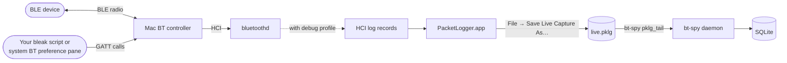

# PacketLogger — sniffing the Mac's own Bluetooth stack

Apple ships a built-in Bluetooth HCI logger called **PacketLogger**. It captures
every BT packet the Mac's own controller handles — at HCI level, plaintext even
on encrypted connections (because the Mac stack has the keys). bt-spy can ingest
both saved `.pklg` files and (where available) a live PacketLogger stream via tailing.

## How it fits



Two-step capture:

1. PL.app records and saves the live capture incrementally to a file
2. bt-spy tails that file in real time, parsing records as PL writes them

The `pklg_tail` source in bt-spy uses an `lsof`-based detector to auto-fill the
file path (PL.app uses U+202F Unicode space in default filenames).

## What PacketLogger sees vs. the dongle

| Scenario                                                  | nRF dongle (OTA) | PacketLogger (HCI) |
| --------------------------------------------------------- | :--------------: | :----------------: |
| Phone app ↔ BLE device (you want to RE the vendor app)    | ✓                | —                  |
| Mac (bleak) ↔ BLE device                                  | ok               | ✓ (cleaner)        |
| Encrypted connections you're a party to                   | needs LTK        | ✓ (plaintext)      |
| Devices that aren't talking to your Mac                   | ✓                | —                  |
| Dev without hardware                                      | —                | ✓                  |

**Cleanest workflow**: use the dongle to RE the vendor protocol from the phone
app, then switch to PacketLogger while you build a bleak-based driver — it
verifies byte-for-byte what your code is sending, with no missed packets.

## Install

PacketLogger ships in Apple's **Additional Tools for Xcode** download:

1. Sign in at <https://developer.apple.com/download/all/> (free Apple ID).
2. Search "Additional Tools for Xcode" — pick the version matching your Xcode.
3. Open the disk image. Drag `PacketLogger.app` (under `Hardware/`) into `/Applications/`.

**Critical second step**: install Apple's Bluetooth Logging Configuration Profile.
PL.app records *nothing* without it on modern macOS.

1. Go to <https://developer.apple.com/bug-reporting/profiles-and-logs/>.
2. Scroll to **Bluetooth** → download the *Bluetooth Logging* `.mobileconfig`.
3. Install via *System Settings → Privacy & Security → Profiles*.
4. **Reboot.**

After reboot PL.app will actually show packets when you hit record.

After install:

```bash
bt-spy doctor
```

…should show ✓ for *PacketLogger (live)* if the bundled CLI binary is present.
If only the GUI is present, the doctor shows `?` — you can still use the
file-import path.

## Use it: file import (works anywhere)

This is the lowest-friction path and what you'll likely use 90% of the time.

1. Open **PacketLogger.app**.
2. Click the red record button (or *File → Live Capture*).
3. Do whatever you wanted to capture: connect from bleak / Mac BT preferences /
   AirDrop / your test script.
4. Click stop. *File → Save As* a `.pklg` file (e.g., `~/captures/foo.pklg`).
5. Import:

   ```bash
   bt-spy import-pklg ~/captures/foo.pklg --label mac_drives_bulb
   ```

   …or use the **Capture** tab in the web UI → *Import a saved .pklg file*.

The imported session works identically to a dongle capture: diff, replay,
protocol-dict entries, MCP — all the same.

## Use it: live capture (when the CLI is present)

```bash
bt-spy capture mac_session --source packetlogger
```

Streams Apple's PacketLogger CLI directly into bt-spy without writing to disk
first. Ctrl-C to stop.

This needs `/Applications/PacketLogger.app/Contents/MacOS/PacketLogger` (or a
binary called `PacketLogger` on PATH). If it's missing, bt-spy will tell you
exactly which install step you missed and point you back at the file-import
path as a fallback.

## A worked example: verifying a bleak driver

Say you reverse-engineered a smart bulb and wrote a driver. You want to confirm
the driver is sending what you think it's sending.

```bash
# Terminal 1: open PacketLogger.app, start a live capture.

# Terminal 2: run your driver
python -c "
import asyncio
from drivers.mismartlight import MiSmartLight
async def main():
    async with MiSmartLight('5A7F1234-AAAA-...') as bulb:
        await bulb.power(True)
        await asyncio.sleep(2)
        await bulb.set_brightness(128)
        await asyncio.sleep(2)
        await bulb.power(False)
asyncio.run(main())
"

# Terminal 1: stop PacketLogger, save as ~/captures/driver_test.pklg

# Terminal 3: ingest + inspect
bt-spy import-pklg ~/captures/driver_test.pklg --label driver_test
bt-spy sessions
bt-spy diff <baseline_id> <driver_test_id>
```

Now diff your driver's session against the original phone-app session — they
should match. Any mismatch is a bug in your encoder.

## Format notes

`.pklg` is Apple's native HCI log format. Each record:

```
+-------------------+
|  length    (u32 BE)|   total record size including this field
|  ts_sec    (u32 BE)|
|  ts_usec   (u32 BE)|
|  type      (u8)    |   00=CMD, 01=EVT, 02=ACL→ctrl, 03=ACL←ctrl, ...
|  payload   ...     |   length - 13 bytes
+-------------------+
```

bt-spy translates each PacketLogger type to a standard HCI H4 frame
(indicator-prefixed) before decoding. The parser is in
[`capture/packetlogger.py`](../src/bt_spy/capture/packetlogger.py); it's about
50 lines of code in case you want to audit it.

## Limitations

- **Mac-only capture path.** PacketLogger needs Apple's CoreBluetooth stack to
  see anything. Linux/Windows users want the dongle path.
- **Doesn't see traffic the Mac isn't part of.** If your phone is the central,
  PacketLogger has nothing to capture. Use the dongle.
- **CLI streaming is best-effort.** Apple's `PacketLogger` CLI flags vary across
  macOS releases. If `--source packetlogger` doesn't behave, fall back to the
  GUI + import flow — it works on every version of macOS.
