# User guide

Everything bt-spy does, by example. Pick whichever workflow matches your goal —
the rest of the docs (architecture, data-model, api-reference, extending) are
there if you want to look under the hood.

## A 60-second tour

<details>
<summary>Dashboard — getting-started checklist</summary>

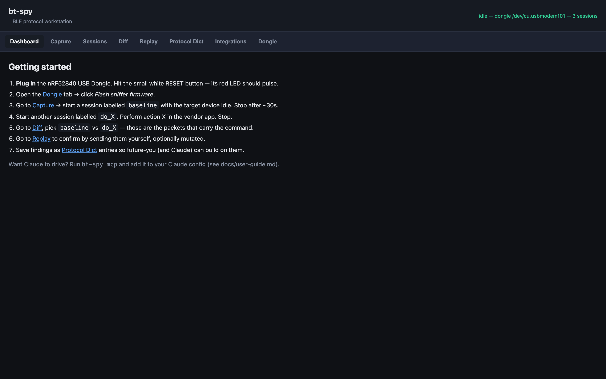
</details>

<details>
<summary>Capture — source, scan/probe, import, mark, live feed</summary>


</details>

<details>
<summary>Sessions — history with View / Summary / pcap</summary>

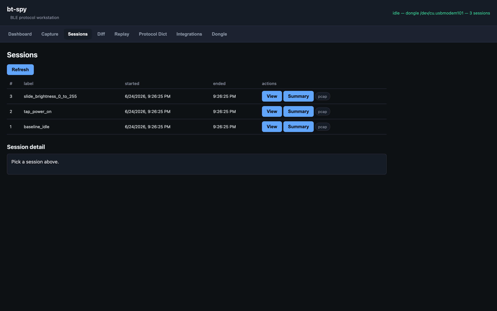
</details>

<details>
<summary>Session detail — device chips, markers, filter, click-into-row</summary>


</details>

<details>
<summary>Packet detail modal — raw + decoded layers + compare-with form</summary>

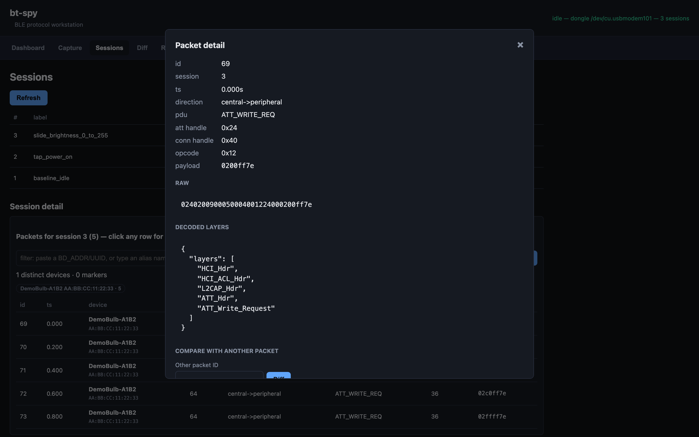
</details>

<details>
<summary>Diff — find what's new between two sessions</summary>

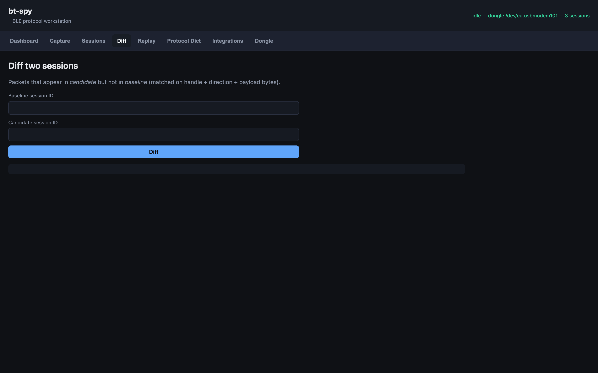
</details>

<details>
<summary>Replay — manual writes + mutation sweep</summary>

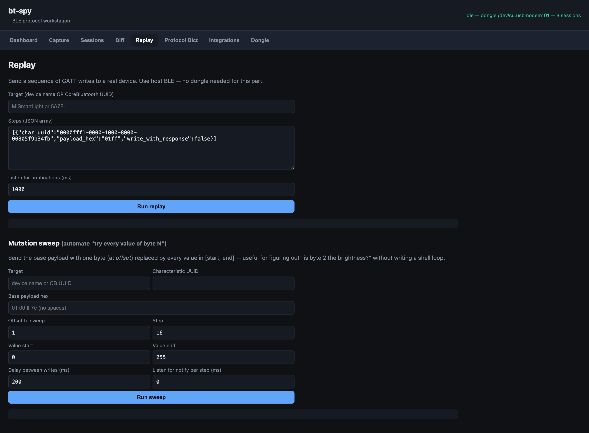
</details>

<details>
<summary>Protocol Dict — your accumulated knowledge</summary>

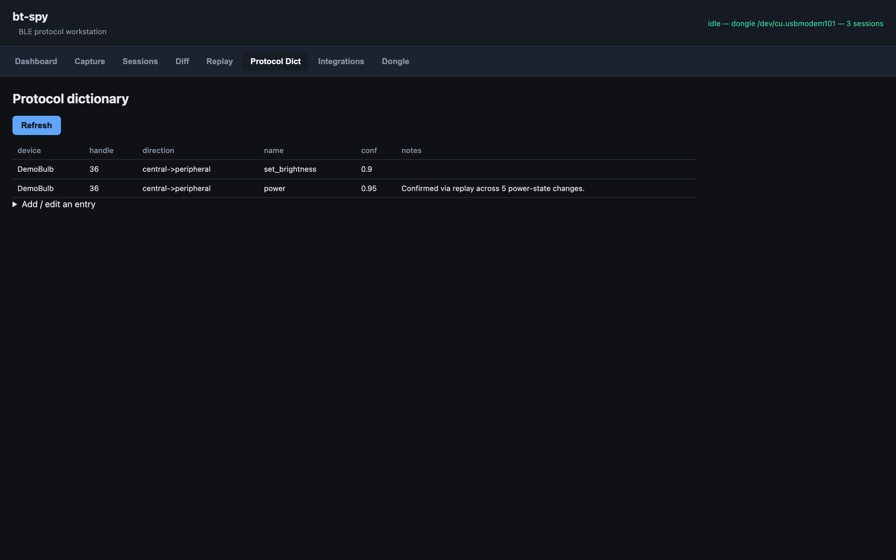

The expanded "Add / edit an entry" form:

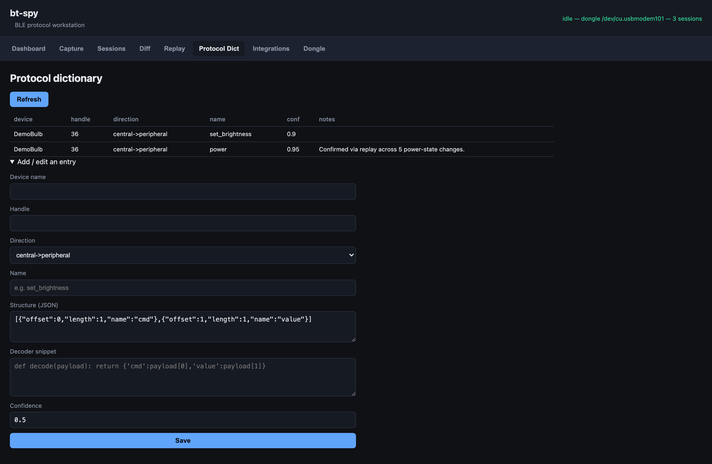
</details>

<details>
<summary>Integrations — driver / HA / MQTT generators</summary>

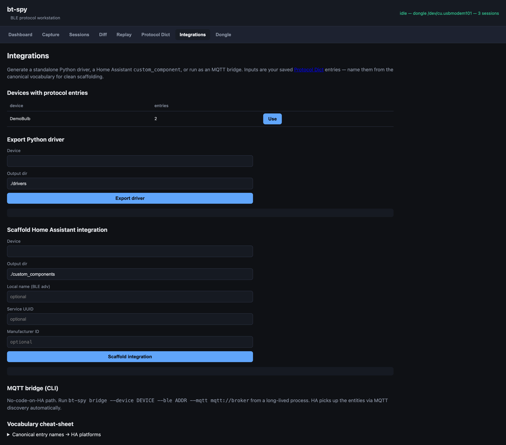
</details>

<details>
<summary>Dongle — flash + LTKs + health</summary>

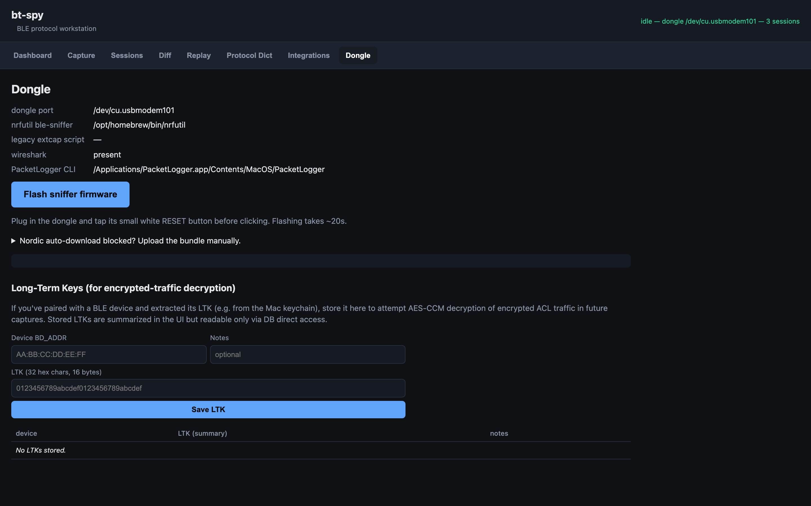
</details>

## What is bt-spy?

A workstation that lets you:

1. **Sniff** Bluetooth Low Energy traffic — from any nearby device (with the
   nRF52840 dongle) or from your Mac's own BT stack (with PacketLogger).
2. **Analyze** what you captured — diff sessions, surface checksums, decode
   payloads, filter by device.
3. **Replay** observed writes against the real device — with mutations to
   confirm hypotheses.
4. **Generate** working artifacts — standalone Python driver, Home Assistant
   integration, or MQTT bridge — from a small knowledge dictionary you build
   along the way.

Optionally let **Claude** drive the whole loop via the MCP server.

## Installation

### macOS

```bash
git clone https://github.com/geekychris/bluetooth_spy.git bt-spy
cd bt-spy
./scripts/install.sh           # creates .venv + pip install -e ".[dev]"
source .venv/bin/activate
bt-spy doctor                  # environment check
```

To capture *over-the-air* (sniff other devices' traffic) you also need the
[nRF52840 Dongle and nrfutil 8.x](firmware-flashing.md).

To capture *your Mac's own BT traffic* you need [PacketLogger.app + Apple's
Bluetooth Debug Profile](packetlogger.md).

For just trying things out via the **Probe** workflow, you need neither —
your Mac's built-in BT works.

### Linux / Windows

Untested. Linux should be a 1-day port: bleak, FastAPI, and Nordic's nrfutil
all run there; the PL.app-related code is Mac-specific and would need a
different host-side path.

## The user interface

```bash
bt-spy serve
# → http://127.0.0.1:8765
```

Seven tabs:

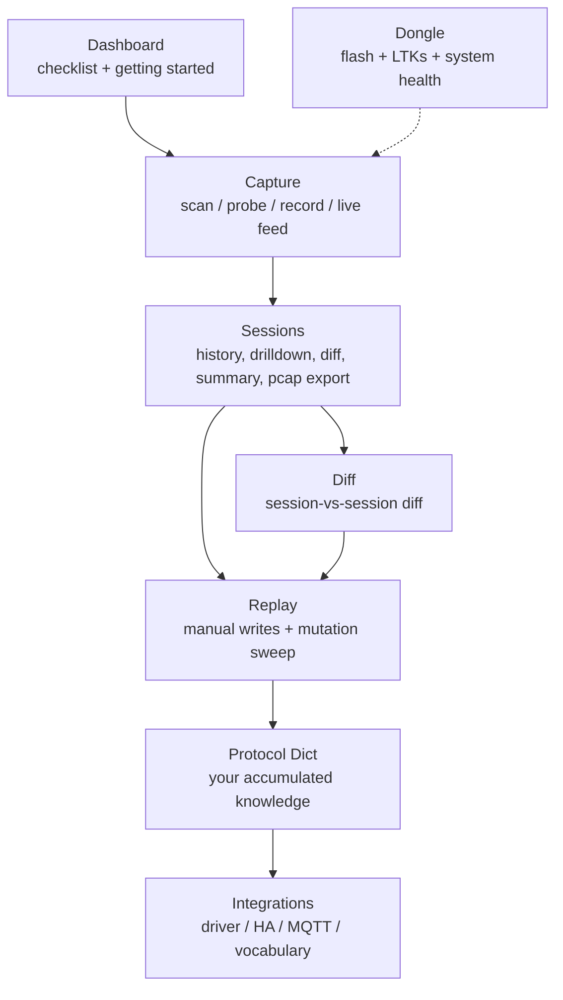

### Capture tab

Three different ways to make packets appear:

1. **Scan + Probe (no hardware required)** — your Mac's BT scans for nearby BLE devices, then connects to one to walk its GATT table. Every read/notify becomes a packet in a new session. This is the fastest way to see bt-spy work end-to-end.

2. **Live PL tail (`pklg_tail`)** — for sniffing traffic your *Mac* is part of (e.g., your Mac talking to AirPods or a smart device you've connected). Requires PL.app and Apple's debug profile.

3. **OTA dongle sniff (`nrf_sniffer`)** — for sniffing traffic between *other* devices (your phone ↔ a smart bulb). Requires the nRF52840 dongle.

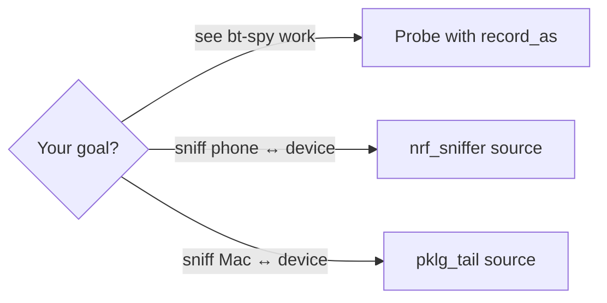

### Sessions tab

Browse what you've captured. Each session row has:

- **View** — load packets into the detail panel with chips for distinct devices and markers. Click any chip to filter; type a name or BD_ADDR in the filter input to filter by that.
- **Summary** — per-handle stats with **Find checksum** buttons.
- **pcap** — download as Wireshark-compatible .pcap.

The detail panel auto-scrolls into view when you click View (so you don't miss it on long pages).

### Replay tab

Two forms:

- **Replay** — send a sequence of GATT writes (with optional mutations) against a real device. Use after you've spotted an interesting command in a capture.
- **Mutation sweep** — same but sweeps one byte across a value range automatically. Use to figure out what a byte means (brightness? color? channel?).

### Protocol Dict tab

The persistent knowledge dictionary. Once you've confirmed a command's structure, save it here with `device_name`, `handle`, `direction`, canonical `name` (from the vocabulary), and `encoder_py` / `decoder_py` snippets. Future you (and Claude) build on these.

### Integrations tab

The output generators. Once a device has protocol entries, click:

- **Export driver** → single-file Python driver class
- **Scaffold integration** → full Home Assistant `custom_component` directory
- (CLI only) MQTT bridge — long-running process with HA discovery

The vocabulary cheat-sheet expanding section shows which entry names auto-scaffold into which HA platforms.

### Dongle tab

Health + LTK storage. The big **Flash sniffer firmware** button is the legacy zip-download path (still works as a fallback). The recommended setup is `nrfutil install ble-sniffer` — see [firmware-flashing.md](firmware-flashing.md).

## The capture screen, in detail

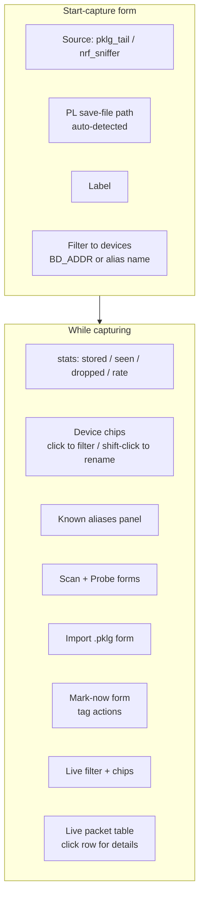

Useful shortcuts inside the live feed:

- **j / k** — navigate packets (highlighted with blue outline)
- **Enter** — open detail modal for highlighted packet
- **x** — focus the Mark Now label input
- **/** — focus the filter input
- **Esc** — close modal or clear filter
- **?** — show help overlay
- **Shift-click** a device chip → rename it (stick a friendly name on a MAC)

## The reverse-engineering workflow

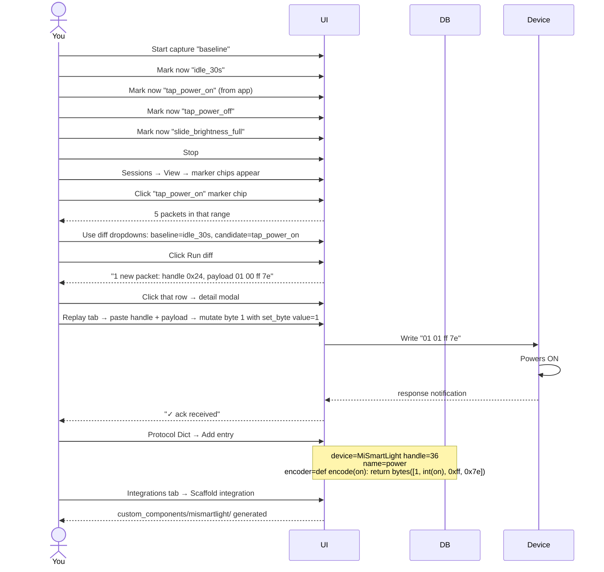

This loop is what bt-spy is built around. The shortcuts in the workflow:

- **Markers** save you from "what packet ID range did that action map to?".
- **Diff** between markers narrows hundreds of packets down to 1-3.
- **Replay with mutations** confirms hypotheses without manual hex editing.
- **Protocol entries with canonical names** (`power`, `set_brightness`, …) make the scaffolders auto-generate the right HA platforms (switch, light, …).

## CLI reference

`bt-spy --help` for the full list. Most-used:

```bash
bt-spy doctor              # environment check
bt-spy serve               # web UI + REST + WS at 127.0.0.1:8765
bt-spy mcp                 # MCP stdio server for Claude

bt-spy capture LABEL --source pklg_tail
bt-spy sessions
bt-spy diff BASELINE_ID CANDIDATE_ID
bt-spy export SESSION_ID --out session.jsonl

bt-spy scan --duration 8
bt-spy probe ADDRESS --record-as my_probe
bt-spy replay TARGET 'JSON_STEPS'

bt-spy export-driver DEVICE --out ./drivers
bt-spy scaffold-ha DEVICE --out ~/.homeassistant/custom_components
bt-spy bridge --device DEVICE --ble ADDR --mqtt mqtt://broker:1883

bt-spy import-pklg FILE --label LABEL

bt-spy flash --bundle ~/Downloads/nrf_sniffer_*.zip   # legacy flash fallback
```

## Letting Claude drive

Add this to your Claude Code config:

```json
{
  "mcpServers": {
    "bt-spy": {
      "command": "bt-spy",
      "args": ["mcp"]
    }
  }
}
```

The MCP server exposes ~18 tools mirroring the CLI/REST surface. Claude can
start captures, query packets, diff sessions, replay with mutations, save
protocol entries, and scaffold integrations — see
[api-reference.md](api-reference.md) for the catalog.

The most useful prompts look like:

> "Look at session 5 — I tapped the brightness slider in the vendor app. Figure
> out the encoding and save a protocol entry."

> "Diff session 3 (baseline) with session 5 (turn-on action) and identify the
> power command."

> "Given the protocol entries you have for MiSmartLight, scaffold a Home
> Assistant integration into `~/.homeassistant/custom_components`."

## Environment variables

| Variable | What | Default |
| --- | --- | --- |
| `BTSPY_DATA_DIR` | Where SQLite + caches live | `~/.bt-spy` |
| `BTSPY_REST_HOST` | UI server bind host | `127.0.0.1` |
| `BTSPY_REST_PORT` | UI server bind port | `8765` |
| `BTSPY_SNIFFER_EXTCAP_PATH` | Override legacy extcap script location | auto-detect |
| `BTSPY_SNIFFER_URL` | Override Nordic sniffer-bundle download URL | (Nordic CDN) |
| `BTSPY_LOG_LEVEL` | DEBUG / INFO / WARNING | INFO |

## What gets stored where

```
~/.bt-spy/
├── bt-spy.db                 # SQLite — sessions, packets, annotations,
├── bt-spy.db-wal             #          protocol_entries, replays,
├── bt-spy.db-shm             #          device_aliases, device_ltks
├── uploads/                  # .pklg files you upload via the UI
├── firmware-cache/           # legacy sniffer zip + Wireshark extcap
└── nrf-sniffer-tail/         # temp pcap files for live nrf_sniffer captures
```

Back up `bt-spy.db` → move to another Mac → continue where you left off.

## Common workflows

### "I want to control my smart bulb from Python"

1. **OTA capture** baseline → action sequence in vendor app → Stop
2. Sessions → **Diff** baseline vs action
3. Sessions → **Summary** → **Find checksum** on the busy handle
4. **Replay** with mutations to confirm structure
5. **Protocol Dict** save the structure with canonical names
6. **Integrations → Export driver** → drop the .py file into your project

### "I want to add my BLE device to Home Assistant"

Same as above, but step 6 is **Integrations → Scaffold integration** → drop the directory into `~/.homeassistant/custom_components/`, restart HA.

### "I want to confirm a fix in my bleak driver"

1. **PacketLogger.app** with debug profile installed → record
2. Run your bleak code
3. Save as `.pklg`, import as a session
4. **Sessions → View** to see exactly what bytes went over the wire
5. Compare with a known-good session via **Diff**

### "I want to know why my device isn't responding to one specific command"

1. **Capture** of a working sequence
2. **Capture** of the broken one
3. **Diff** — see which packet differs
4. **Click into the differing packet** → byte-level **Compare with another packet** in the modal → spot the bad byte

## Troubleshooting

### `bt-spy doctor` shows ✗ for the dongle

Plug it in, then re-run. Some USB-C adapters are flaky for the dongle — try another port.

### Capture says "starting…" forever

Open the browser console — there's likely a 4xx or 5xx error coming back. The capture daemon may also be hung; refresh the page and use the **Force stop existing** button in the error banner.

### Live feed empty even though packets are arriving

Check the *filter chips* — clicking one and forgetting it is the #1 cause. Click the **clear** button below the filter bar.

### `device_addr` column blank on nrf_sniffer captures

Only advertising frames carry the BD_ADDR directly. For connected ACL packets we backfill via the daemon's conn_handle→addr map. If you start a capture mid-connection, those backfills won't fire. Restart your capture *before* connecting from the phone.

### "PL is writing to but I see weird Unicode in the path"

macOS uses U+202F (narrow no-break space) in default save-as filenames. Click the **Detect** button in the Capture form — it uses `lsof -F` which round-trips Unicode safely.

## Related docs

- [Architecture](architecture.md) — system layers + sequence diagrams
- [Data model](data-model.md) — SQLite schema + ER diagram
- [API reference](api-reference.md) — REST + WS + MCP catalog
- [Extending](extending.md) — add decoders, mutations, capture sources
- [Firmware flashing](firmware-flashing.md) — dongle setup
- [PacketLogger](packetlogger.md) — Mac-side HCI capture
- [Protocol RE tutorial](protocol-re-tutorial.md) — end-to-end worked example
- [Home Assistant integration](home-assistant.md) — driver + scaffold + bridge
